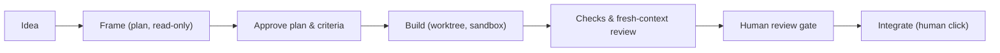
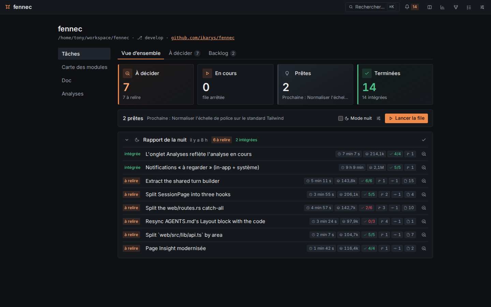

<p align="center">
  
</p>

<h1 align="center">fennec</h1>

<p align="center">
  <strong>AI-assisted development that keeps you the author of your software.</strong>
</p>

<p align="center">
  <em>AI-written code is abundant. Understanding, mastery and responsibility are rare.<br>fennec tools what is rare.</em>
</p>

<p align="center">
  <a href="https://ikarys.github.io/fennec/">Website</a> &nbsp;·&nbsp; Linux &nbsp;·&nbsp; one Rust binary &nbsp;·&nbsp; local models first &nbsp;·&nbsp; AGPL-3.0
</p>

---

Most coding agents optimise for writing code fast. fennec is for professional developers who work with AI and want to stay the authors of their software: you frame the work, the agent loop runs the steps, then waits for your review. Nothing is integrated without a human decision.

Status: early. Linux and macOS; on Windows, through WSL2.

## Why fennec

- **Nothing integrates without a human decision.** The "Intégrer" click runs only after a review gate; its blockers are accepted one by one.
- **Provenance is shown.** Everything the UI shows is marked *verified* (computed by fennec, deterministic) or *indicative* (produced by a model). You always know what to trust.
- **The approved plan is a contract.** Its "Done when" criteria are checked by commands fennec runs itself, not by the model's word, then reviewed by fresh agents that did not write the code.
- **Guards catch a model gaming the gate.** Protected files, silenced lints/tests, removed assertions, architecture rules, and ADRs can block integration until the human accepts them.
- **Sandbox by default.** Commands run in bwrap with a read-only system, hidden secrets, and no network by default; every workflow gets its own git worktree.
- **Decisions are recorded, even at night.** Agents record each choice with its reason and the alternatives. A night mode runs your ready ideas unattended, within per-idea caps on time and tokens, and leaves a report for the morning.
- **Local-first and frugal.** Any OpenAI-compatible endpoint works, a local model included. The prompt only grows, so the inference cache is reused turn after turn. fennec ships as one Rust binary with an embedded UI and SQLite.

## How it works



An idea is framed in a read-only plan session, then the human approves the plan and its "Done when" criteria. The builder works in a dedicated worktree and sandbox. fennec runs the criterion checks, verifies the result in a fresh context, and presents findings at a review gate. Integration happens only on the human's "Intégrer" click.

## Features

### Agent loop & sessions

- Agent loop on the command line and in a web UI with session tabs, a command palette, home, and themes.
- Human pause with `ask_user`; clean stop; open tool calls are closed after a stop or crash.
- Automatic and manual compaction; the new window opens from the model's summary plus facts from the log.
- Agents (`*.agent.md`) with plan and builder modes, fixed plan and report formats.
- Skills (`SKILL.md` packages), typed `/compact` and `/<skill>` commands, and a skills panel.
- Vision: images attached to messages, `read_file` returns images, and a context panel shows what the model saw.
- Replay of a typed message; the log stays append-only.
- Web search through SearXNG and an embedded browser skill using Playwright.

### Workflows

- Workflow graphs of agent, shell, human, condition, and parallel/join nodes wired by named ports.
- A visual editor; loops are capped per edge; runs can pause on edges or step by step.
- Fresh agents and parallel branches run in child sessions.
- The default workflow runs criteria checks, verifies in a fresh context with `verify` and `review` sub-agents, and sends findings back to the builder.
- A session that runs a workflow works in its own git worktree and branch; your checkout is never written.
- Preview: HTML and Markdown blocks of a message, and the `.html`/`.md` files an agent wrote, rendered in a sandboxed origin.

### Review & integration

- Criteria: the approved plan's "Done when" list is the run's contract; a `criteria` node runs each `check:` command itself, and agent nodes with `verdicts` judge the others.
- Protected files: fennec defaults and project `.agents/protected` are refused to file tools and mounted read-only in the sandbox.
- Integration: the "Intégrer" button runs a cherry-pick of a session's worktree branch into the human's repository after a review gate. Git hooks do not run on it (see "Security model").
- Review gate blockers include commits, files, criteria, protected files touched, architecture violations, and bypass detection.
- Bypass detection flags added lines that silence a lint, type check, or test, and tests or assertions removed on balance.
- Architecture guard: `.agents/architecture` rules are checked on lines an integration adds; a violation is a blocker.
- ADRs: MADR files in `docs/adr/` are listed and protected.
- Protected tests: an unchecked "Protéger les tests intégrés" box in the integration dialog appends integrated test files to `.agents/protected`.

### Ideas & night mode



- The project page keeps the human's ideas; "Cadrer" opens a plan session tied to the idea; the approved plan marks the idea ready, verbatim.
- "Lancer la file" runs the ready ideas one at a time, oldest first, each through the default workflow (plan, build, criteria checks, fresh-context verify and review) in its own session and git worktree.
- Night mode ("Mode nuit" box): the queue runs with the human away; `ask_user` answers itself, the agent decides and records the decision with its reason, and changing the acceptance criteria is refused.
- Per-idea caps on duration and tokens (Settings) stop an idea; the queue goes on with the next one.
- In the morning: a night report lists each idea run with its duration, tokens, criteria passed, decisions taken and files changed, until marked read; integrating stays the human's click, one idea at a time.
- The board groups ideas by stage (to decide, running, ready, done) with one next action per idea, computed by the server; a cross-project backlog and a "à regarder" counter in the top bar point to what needs the human's eye.

### Project understanding

- Project page shows modules and dependencies read from imports, and writes them to `docs/map.md` on the human's click; the map is marked stale when the code moved.
- ADRs from `docs/adr/` are listed as project documentation.
- Project analysis opens a read-only `analyze` agent session that drafts AGENTS.md philosophy, layers, and rules with file:line sources.

### Settings & models

- Settings page stores per-model parameters, display defaults, and provider settings in SQLite.
- Several providers; the model can be changed per session from the composer.
- The SearXNG instance for web search, the sandbox and its network are set on the Settings page.
- A usage ledger: calls, tokens and speeds per model, kept beyond sessions.
- API keys are sealed at rest with `secret.key` next to the store.

### Budgets and billed models

- A project can have a monthly cost budget, set from a tile on its project page.
- The month's spend is the usage ledger priced at each model's price (Settings, Models; per million tokens: input, cached, output).
- At 80 % an alert shows, once exceeded a new turn is refused until the budget is raised or removed.
- Only billed models count: a model on the local provider is not billed by default (its price is an estimate, kept for comparison), a paid provider's model is; the Billed checkbox of each model overrides it. Every price stays displayed either way.

## Platforms

- Linux x86_64 and aarch64: full support; the command sandbox is bubblewrap.
- macOS Apple Silicon and Intel: binaries and launchd service; the command sandbox is Seatbelt (`sandbox-exec`, part of macOS). It hides the same secrets and cuts the same network; commands write their own `TMPDIR`, not `/tmp`, and a protected file's parent directory can be renamed (the review gate still sees the file changed).
- Windows: through WSL2 only, with the same `install.sh`, the browser on Windows opens http://127.0.0.1:7777.

Why not native Windows: fennec's security model rests on the command sandbox: what a model writes runs with the system read-only, the human's secrets (`~/.ssh`, cloud credentials) hidden and no network by default. Linux has bubblewrap and macOS has Seatbelt for that; Windows has no equivalent that an unprivileged program can set up as simply (AppContainer and job objects cover only part of it). Shipping fennec on Windows without that wall would break the promise the review gate relies on; WSL2 gives Windows users the Linux sandbox today. Native Windows can come back if a sound sandbox does.

## Install

```bash
curl -fsSL https://raw.githubusercontent.com/ikarys/fennec/main/install.sh | sh
```

The script installs the latest release (`x86_64`/`aarch64` Linux, Apple Silicon/Intel macOS) into `~/.local/bin` after
checking its checksum; `FENNEC_VERSION` picks a tag, `FENNEC_INSTALL_DIR` the directory. With
[mise](https://mise.jdx.dev): `mise use -g github:ikarys/fennec`. Or download a tarball from the
[releases](../../releases) by hand.

Linux requirements: glibc 2.35 or later (Ubuntu 22.04, Debian 12 and newer) and `bwrap` (package `bubblewrap`) for the command sandbox. On Ubuntu 23.10 and later, AppArmor forbids the user namespaces bwrap needs; the Settings page says so and [docs/releasing.md](docs/releasing.md#installing-a-binary) gives the fix.

### From source

Needs Rust (stable), Node.js and [just](https://github.com/casey/just).

```bash
just            # build the UI, then run the release server on http://127.0.0.1:7777
just check      # the contributor gate: formatting, clippy, tests, UI build
```

### Run as a service, update

`install.sh` also writes a systemd user service (`~/.config/systemd/user/fennec.service`, never overwritten
once there) and starts it; `FENNEC_SERVICE=none` skips that. Without a systemd user session, run `fennec serve`
yourself. Put the model variables of "Configuration" in the unit as `Environment=` lines if you use them.

```bash
journalctl --user -u fennec -f         # its logs
sudo loginctl enable-linger "$USER"    # start at boot, before any login
fennec update --check                  # is a newer release out?
fennec update                          # install it (the service restarts on it)
```

On macOS, `install.sh` writes a launchd user agent (`~/Library/LaunchAgents/dev.fennec.plist`, never overwritten, with the PATH of the shell that ran the installer) and starts it; `FENNEC_SERVICE=none` skips it. Logs go to `~/Library/Logs/fennec.log`; `launchctl kickstart -k gui/$(id -u)/dev.fennec` restarts it.

The top bar shows an arrow when a newer release is out; a click installs it and the server restarts on it
(refused while a turn runs). Under WSL, systemd must be on (`[boot]` `systemd=true` in `/etc/wsl.conf`).

## Quick start

```bash
fennec doctor                   # what is missing: model, sandbox, git, a project, scanners
fennec                          # web UI on http://127.0.0.1:7777
cd ~/code/my-project && fennec run "add a --verbose flag"   # or the CLI
```

Point fennec at a model with `FENNEC_LLM_URL` (or add providers on the Settings page), open a
project folder from the home page, describe the change and approve the plan.

Port 7777 taken? `fennec --port 7788`, or set it for good in `~/.config/fennec/settings.yaml` (`port: 7788`),
also editable on Settings > Security > Network.

### Remote access

fennec listens on 127.0.0.1 only, and needs no password there. To use it from another machine
(fennec on a NAS, say), set a password and allow remote connections on Settings > Security > Network,
then restart from there. Or, from a shell:

```bash
fennec password                                       # stores a PBKDF2 hash in ~/.config/fennec/settings.yaml
echo "listen: 0.0.0.0" >> ~/.config/fennec/settings.yaml
fennec                                                # refuses a non-local address without a password
```

A remote browser gets a login page, then a session cookie (30 days, lost when fennec restarts).
Local use stays password-free. fennec speaks plain HTTP: across an untrusted network, put it behind
TLS, for example Tailscale, an SSH tunnel (`ssh -L 7777:127.0.0.1:7777 nas`, no password needed) or a
reverse proxy. A reverse proxy must pass the original `Host` (Caddy does by default; nginx needs
`proxy_set_header Host $host;`):

```
fennec.example.lan {
    reverse_proxy 127.0.0.1:7777
}
```

The play button's servers and the preview still bind 127.0.0.1: open them through an SSH tunnel.

## Configuration

| Variable | Default | Notes |
| --- | --- | --- |
| `FENNEC_LLM_URL` | `http://127.0.0.1:8000/v1` | OpenAI-compatible endpoint of the `local` provider |
| `FENNEC_MODEL` | first model the endpoint lists | Model of the `local` provider |
| `FENNEC_API_KEY` | none | API key of the `local` provider |
| `FENNEC_MAX_TOKENS` | `32000` | Output token limit of a model call |
| `FENNEC_COMPACT_AT` | `0.85`; `0` disables | Context threshold for automatic compaction |
| `FENNEC_DB` | `~/.local/share/fennec/fennec.db` | SQLite store |
| `FENNEC_USAGE_DB` | `usage.db` next to the store | Usage ledger |

These are defaults: the Settings page adds providers and overrides parameters per model, from the next turn on.

## Security model

- The human owns the CLI/UI and configuration; fennec never blocks them.
- The code that decides, such as integration, never runs what a model wrote.
- The server answers local pages only (`Host`/`Origin` checked, JSON bodies); a remote caller needs the password set with `fennec password` (see "Remote access").
- **Git hooks do not run on fennec's own git commands.** Every git command fennec runs itself (the commit that saves each turn's work in its worktree, the integration's cherry-pick and commit, status and diffs) passes `-c core.hooksPath=/dev/null -c core.fsmonitor=false`: a hook or fsmonitor in a repository may have been written by a model, and fennec's kernel never executes one. Your hooks still run on your own `git commit`; if a check matters (a commit-message format, a linter), run it in your own workflow after integrating, or make it a criterion's `check:` command.
- Git's metadata (`.git`) is read-only inside the command sandbox and refused to the file tools, with no waiver: an agent cannot change the repository's config, hooks or refs through them.
- Model output is untrusted. Commands run in a sandbox (bubblewrap on Linux, Seatbelt on macOS) unless the human turns it off; protected files are refused to file tools and read-only in the sandbox. **What the sandbox blocks, and how to run the app, add a dependency or see the agent's work anyway: [docs/sandbox.md](docs/sandbox.md).**
- The server only answers local pages: `Host` and `Origin` must be `127.0.0.1` or `localhost` and POST bodies must be JSON, so no web page can drive the agent.
- Known gap: the file tools run in fennec's process behind a working-directory guard, and a command can create a new file matching a protected pattern where none existed; the review gate is there to catch it.

## Documentation

- [docs/sandbox.md](docs/sandbox.md): the command sandbox: what it blocks, how to run, test and see the agent's work
- [CONTRIBUTING.md](CONTRIBUTING.md): how to contribute, licence of contributions
- [AGENTS.md](AGENTS.md): architecture, conventions
- [docs/api.md](docs/api.md): HTTP API and event format
- [docs/workflows.md](docs/workflows.md): workflow format and run semantics
- [docs/ui.md](docs/ui.md): UI design rules
- [docs/releasing.md](docs/releasing.md): branches, versions, binaries
- [docs/dogfooding.md](docs/dogfooding.md): what fennec building fennec taught us

## How fennec is written

fennec is built with AI, under a human's direction and review: the human frames each change,
reviews it and decides what is merged. The models that wrote code:

- Claude (Anthropic): Opus 5.5, Fable 5.1, Sonnet 5.5;
- Qwen3.8-27B, run locally, both through fennec itself and as an executor Claude delegated to.

Each commit names the models that wrote it in `Co-Authored-By:` trailers. That record is
incomplete before 2026-11-07: Claude's trailers are missing on part of the commits, and the
local Qwen's on most of the work delegated to it. On 2026-11-07 the history was rewritten once
to add the trailers that could be proven: each commit fennec integrated (`Fennec-Session:`) got
the models its session log or usage ledger recorded; twenty sessions deleted before the ledger
existed were credited to Qwen3.8-27B, the only model fennec had ever been configured with.
Contributors follow the same rule (`CONTRIBUTING.md`).

## License

fennec is licensed under [AGPL-3.0-only](LICENSE).

fennec started from [openfox](https://github.com/co-l/openfox), rewritten in Rust; the MIT notice is kept in [THIRD_PARTY.md](THIRD_PARTY.md).
