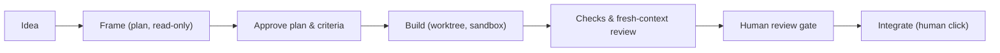

# fennec

**AI-assisted development that keeps you the author of your software.**

Most coding agents optimise for writing code fast. fennec's thesis is that AI-written code is abundant, while understanding, mastery and responsibility are rare; it tools what is rare. You frame the work, the agent loop runs the steps, then waits for your review; nothing is integrated without a human decision.

Status: early, Linux only. fennec is a Rust port of [openfox](https://github.com/co-l/openfox) grown into its own layer.

## Why fennec

- **Nothing integrates without a human decision.** The "Intégrer" click runs only after a review gate; its blockers are accepted one by one.
- **Provenance is shown.** Everything the UI shows is marked *verified* (computed by fennec, deterministic) or *indicative* (produced by a model). You always know what to trust.
- **The approved plan is a contract.** Its "Done when" criteria are checked by commands fennec runs itself, not by the model's word, then reviewed by fresh agents that did not write the code.
- **Guards catch a model gaming the gate.** Protected files, silenced lints/tests, removed assertions, architecture rules, and ADRs can block integration until the human accepts them.
- **Sandbox by default.** Commands run in bwrap with a read-only system, hidden secrets, and no network by default; every workflow gets its own git worktree.
- **Decisions are recorded, even at night.** Agents record each choice with its reason and the alternatives. A night mode runs your ready ideas unattended, within per-idea caps on time and tokens, and leaves a report for the morning.
- **Local-first and frugal.** Any OpenAI-compatible endpoint works, a local model included. The prompt only grows, so the inference cache is reused turn after turn. fennec ships as one Rust binary with an embedded UI and SQLite.

## How it works



An idea is framed in a read-only plan session, then the human approves the plan and its "Done when" criteria. The builder works in a dedicated worktree and sandbox. fennec runs the criterion checks, verifies the result in a fresh context, and presents findings at a review gate. Integration happens only on the human's "Intégrer" click.

## Features

### Agent loop & sessions

- Agent loop on the command line and in a web UI with session tabs, a command palette, home, and themes.
- Human pause with `ask_user`; clean stop; open tool calls are closed after a stop or crash.
- Automatic and manual compaction; the new window opens from the model's summary plus facts from the log.
- Agents (`*.agent.md`) with plan and builder modes, fixed plan and report formats.
- Skills (`SKILL.md` packages), typed `/compact` and `/<skill>` commands, and a skills panel.
- Vision: images attached to messages, `read_file` returns images, and a context panel shows what the model saw.
- Replay of a typed message; the log stays append-only.
- Web search through SearXNG and an embedded browser skill using Playwright.

### Workflows

- Workflow graphs of agent, shell, human, condition, and parallel/join nodes wired by named ports.
- A visual editor; loops are capped per edge; runs can pause on edges or step by step.
- Fresh agents and parallel branches run in child sessions.
- The default workflow runs criteria checks, verifies in a fresh context with `verify` and `review` sub-agents, and sends findings back to the builder.
- A session that runs a workflow works in its own git worktree and branch; your checkout is never written.
- Preview: HTML and Markdown blocks of a message, and the `.html`/`.md` files an agent wrote, rendered in a sandboxed origin.

### Review & integration

- Criteria: the approved plan's "Done when" list is the run's contract; a `criteria` node runs each `check:` command itself, and agent nodes with `verdicts` judge the others.
- Protected files: fennec defaults and project `.agents/protected` are refused to file tools and mounted read-only in the sandbox.
- Integration: the "Intégrer" button runs a cherry-pick of a session's worktree branch into the human's repository after a review gate.
- Review gate blockers include commits, files, criteria, protected files touched, architecture violations, and bypass detection.
- Bypass detection flags added lines that silence a lint, type check, or test, and tests or assertions removed on balance.
- Architecture guard: `.agents/architecture` rules are checked on lines an integration adds; a violation is a blocker.
- ADRs: MADR files in `docs/adr/` are listed and protected.
- Protected tests: an unchecked "Protéger les tests intégrés" box in the integration dialog appends integrated test files to `.agents/protected`.

### Project understanding

- Project page shows modules and dependencies read from imports, and writes them to `docs/map.md` on the human's click; the map is marked stale when the code moved.
- ADRs from `docs/adr/` are listed as project documentation.
- Project analysis opens a read-only `analyze` agent session that drafts AGENTS.md philosophy, layers, and rules with file:line sources.
- Ideas backlog keeps the human's ideas per project; "Cadrer" opens a plan session tied to the idea.
- "Lancer la file" runs ready ideas one at a time, oldest first, through the default workflow in each idea's session and worktree.
- Night mode runs the queue with the human away; per-idea caps stop an idea, and each started idea shows its criteria and decisions for the morning.

### Settings & models

- Settings page stores per-model parameters, display defaults, and provider settings in SQLite.
- Several providers; the model can be changed per session from the composer.
- The SearXNG instance for web search, the sandbox and its network are set on the Settings page.
- A usage ledger: calls, tokens and speeds per model, kept beyond sessions.
- API keys are sealed at rest with `secret.key` next to the store.

## Install

### From a release tarball

1. Download `fennec-<version>-<target>.tar.gz` and its `.sha256` from a [release](../../releases) (`x86_64` and `aarch64` Linux).
2. Run `sha256sum -c fennec-<label>-<target>.tar.gz.sha256`.
3. Extract and run `./fennec --version`.

The `edge` prerelease is the latest develop build, installed the same way; it is not a release.

Requirements: glibc 2.35 or later (Ubuntu 22.04, Debian 12 and newer) and `bwrap` (package `bubblewrap`) for the command sandbox. On Ubuntu 23.10 and later, AppArmor forbids the user namespaces bwrap needs; the Settings page says so and [docs/releasing.md](docs/releasing.md#installing-a-binary) gives the fix.

### From source

Needs Rust (stable), Node.js and [just](https://github.com/casey/just).

```bash
just            # build the UI, then run the release server on http://127.0.0.1:7777
just check      # the contributor gate: formatting, clippy, tests, UI build
```

## Quick start

```bash
fennec                          # web UI on http://127.0.0.1:7777
cd ~/code/my-project && fennec run "add a --verbose flag"   # or the CLI
```

Point fennec at a model with `FENNEC_LLM_URL` (or add providers on the Settings page), open a
project folder from the home page, describe the change and approve the plan.

## Configuration

| Variable | Default | Notes |
| --- | --- | --- |
| `FENNEC_LLM_URL` | `http://127.0.0.1:8000/v1` | OpenAI-compatible endpoint of the `local` provider |
| `FENNEC_MODEL` | first model the endpoint lists | Model of the `local` provider |
| `FENNEC_API_KEY` | none | API key of the `local` provider |
| `FENNEC_MAX_TOKENS` | `32000` | Output token limit of a model call |
| `FENNEC_COMPACT_AT` | `0.85`; `0` disables | Context threshold for automatic compaction |
| `FENNEC_DB` | `~/.local/share/fennec/fennec.db` | SQLite store |
| `FENNEC_USAGE_DB` | `usage.db` next to the store | Usage ledger |

These are defaults: the Settings page adds providers and overrides parameters per model, from the next turn on.

## Security model

- The human owns the CLI/UI and configuration; fennec never blocks them.
- The code that decides, such as integration, never runs what a model wrote.
- Model output is untrusted. Commands run in a bwrap world unless the human turns it off; protected files are refused to file tools and read-only in the sandbox.
- The server only answers local pages: `Host` and `Origin` must be `127.0.0.1` or `localhost` and POST bodies must be JSON, so no web page can drive the agent.
- Known gap: the file tools run in fennec's process behind a working-directory guard, and a command can create a new file matching a protected pattern where none existed; the review gate is there to catch it.

## Documentation

- [AGENTS.md](AGENTS.md): architecture, conventions, contributor guide
- [docs/api.md](docs/api.md): HTTP API and event format
- [docs/workflows.md](docs/workflows.md): workflow format and run semantics
- [docs/ui.md](docs/ui.md): UI design rules
- [docs/releasing.md](docs/releasing.md): branches, versions, binaries
- [docs/dogfooding.md](docs/dogfooding.md): what fennec building fennec taught us

## License

fennec is licensed under [AGPL-3.0-only](LICENSE). The openfox MIT notice is kept in [THIRD_PARTY.md](THIRD_PARTY.md).
