# Project map

Generated by fennec from the import lines of the source files: do not edit, regenerate it.
Each box is a module (a directory); an arrow `A --> B` means code in A imports code in B, labelled with the number of importing files.

```mermaid
graph LR
  m0["crates/fennec/src/agent/tool_calls"]
  m1["crates/fennec/src/cli"]
  m2["crates/fennec/src/tools/run_command"]
  m3["crates/fennec/src/tools/web_fetch"]
  m4["crates/fennec/src/web/routes/integration"]
  m5["crates/fennec/src/web"]
  m6["crates/fennec/src/web/routes"]
  m7["crates/fennec/src/plugins"]
  m8["crates/fennec/src/web/os"]
  m9["crates/fennec/src/web/streams"]
  m10["crates/fennec/src/web/views/run_view"]
  m11["crates/fennec/src/web/views"]
  m12["crates/fennec/src/web/jobs"]
  m13["crates/fennec/src/agent/workflow"]
  m14["crates/fennec/src"]
  m15["crates/fennec/src/llm"]
  m16["crates/fennec/src/domain/risk"]
  m17["crates/fennec/src/worktree"]
  m18["crates/fennec/src/agents"]
  m19["crates/fennec/src/agent"]
  m20["crates/fennec/src/tools"]
  m21["crates/fennec/src/agent/turn"]
  m22["crates/fennec/src/domain/workflow"]
  m23["crates/canvas/src"]
  m24["crates/fennec/src/mcp"]
  m25["crates/fennec/src/sandbox"]
  m26["crates/fennec/src/store"]
  m27["crates/mcp-lite/src/oauth"]
  m28["crates/fennec/src/domain"]
  m29["crates/rules/src"]
  m30["crates/fennec/src/domain/preferences"]
  m31["crates/mcp-lite/src"]
  m32["crates/fennec/src/domain/module_map"]
  m33["crates/fennec/src/domain/event"]
  m34["crates/token-usage/src"]
  m35["crates/backlog/src"]
  m36["web/src"]
  m37["web/src/components/layout"]
  m38["web/src/pages"]
  m39["web/src/components/agents"]
  m40["web/src/components/editor"]
  m41["web/src/components/project"]
  m42["web/src/components/project/ideas"]
  m43["web/src/components/workflow"]
  m44["web/src/components/plugins"]
  m45["web/src/components/rules"]
  m46["web/src/components/workflow/fields"]
  m47["web/src/components/workflow/nodes"]
  m48["web/src/components/ui"]
  m49["web/src/hooks"]
  m50["web/src/components/session"]
  m51["web/src/components/workflow/session"]
  m52["web/src/components/canvas"]
  m53["web/src/components/preview"]
  m54["web/src/lib"]
  m55["web/src/components/settings"]
  m56["web/src/lib/api"]
  m57["web/src/i18n"]
  m58["crates/fennec"]
  m59["crates/token-usage/tests"]
  m60["docs/users/theme"]
  m61["web"]
  m62["web/scripts"]
  m14 -->|1| m35
  m14 -->|3| m19
  m14 -->|1| m21
  m14 -->|1| m18
  m14 -->|20| m28
  m14 -->|3| m33
  m14 -->|2| m32
  m14 -->|2| m30
  m14 -->|1| m16
  m14 -->|1| m22
  m14 -->|1| m15
  m14 -->|1| m24
  m14 -->|3| m25
  m14 -->|4| m26
  m14 -->|1| m20
  m14 -->|4| m17
  m14 -->|1| m29
  m14 -->|3| m34
  m19 -->|1| m21
  m19 -->|16| m28
  m19 -->|20| m33
  m19 -->|2| m30
  m19 -->|1| m22
  m19 -->|1| m20
  m19 -->|3| m29
  m0 -->|1| m19
  m0 -->|1| m28
  m0 -->|1| m33
  m0 -->|1| m29
  m21 -->|1| m28
  m21 -->|1| m33
  m21 -->|1| m30
  m13 -->|1| m19
  m13 -->|3| m21
  m13 -->|3| m28
  m13 -->|4| m33
  m13 -->|4| m22
  m18 -->|2| m28
  m1 -->|6| m14
  m1 -->|1| m19
  m1 -->|1| m21
  m1 -->|1| m18
  m1 -->|5| m28
  m1 -->|2| m33
  m1 -->|2| m26
  m28 -->|2| m35
  m28 -->|9| m33
  m28 -->|1| m32
  m28 -->|1| m30
  m28 -->|1| m31
  m28 -->|4| m29
  m28 -->|2| m34
  m22 -->|3| m28
  m22 -->|2| m33
  m15 -->|2| m14
  m15 -->|1| m19
  m15 -->|1| m28
  m15 -->|1| m33
  m24 -->|1| m14
  m24 -->|2| m28
  m24 -->|1| m30
  m24 -->|2| m25
  m24 -->|2| m26
  m24 -->|1| m31
  m24 -->|1| m27
  m7 -->|3| m14
  m7 -->|4| m28
  m7 -->|2| m25
  m7 -->|2| m26
  m25 -->|1| m30
  m26 -->|1| m35
  m26 -->|1| m14
  m26 -->|1| m19
  m26 -->|9| m28
  m26 -->|3| m33
  m26 -->|1| m30
  m26 -->|1| m27
  m20 -->|1| m23
  m20 -->|2| m14
  m20 -->|2| m19
  m20 -->|8| m28
  m20 -->|8| m33
  m20 -->|1| m30
  m20 -->|1| m24
  m20 -->|1| m25
  m20 -->|2| m29
  m2 -->|3| m33
  m2 -->|2| m25
  m3 -->|1| m33
  m5 -->|5| m14
  m5 -->|2| m19
  m5 -->|2| m21
  m5 -->|1| m13
  m5 -->|4| m28
  m5 -->|2| m33
  m5 -->|1| m30
  m5 -->|1| m22
  m5 -->|1| m7
  m5 -->|1| m25
  m5 -->|3| m26
  m5 -->|1| m20
  m5 -->|2| m6
  m5 -->|1| m17
  m12 -->|3| m35
  m12 -->|4| m14
  m12 -->|4| m19
  m12 -->|1| m13
  m12 -->|5| m28
  m12 -->|2| m33
  m12 -->|3| m30
  m12 -->|2| m22
  m12 -->|3| m15
  m12 -->|5| m26
  m12 -->|1| m5
  m12 -->|1| m34
  m8 -->|1| m14
  m8 -->|2| m28
  m8 -->|3| m5
  m8 -->|1| m17
  m6 -->|5| m35
  m6 -->|4| m23
  m6 -->|24| m14
  m6 -->|12| m19
  m6 -->|2| m13
  m6 -->|5| m18
  m6 -->|30| m28
  m6 -->|10| m33
  m6 -->|4| m30
  m6 -->|2| m22
  m6 -->|2| m24
  m6 -->|1| m7
  m6 -->|2| m25
  m6 -->|6| m26
  m6 -->|36| m5
  m6 -->|2| m12
  m6 -->|3| m8
  m6 -->|1| m9
  m6 -->|7| m11
  m6 -->|1| m10
  m6 -->|4| m17
  m6 -->|4| m29
  m6 -->|3| m34
  m4 -->|2| m35
  m4 -->|2| m14
  m4 -->|2| m19
  m4 -->|1| m18
  m4 -->|2| m28
  m4 -->|1| m33
  m4 -->|2| m22
  m4 -->|1| m25
  m4 -->|1| m26
  m4 -->|2| m5
  m4 -->|1| m12
  m4 -->|1| m6
  m4 -->|1| m11
  m4 -->|2| m17
  m9 -->|2| m14
  m9 -->|1| m19
  m9 -->|1| m28
  m9 -->|2| m26
  m9 -->|2| m5
  m9 -->|1| m12
  m9 -->|1| m17
  m9 -->|1| m34
  m11 -->|3| m35
  m11 -->|2| m14
  m11 -->|8| m28
  m11 -->|5| m33
  m11 -->|1| m22
  m11 -->|2| m26
  m11 -->|3| m5
  m11 -->|1| m12
  m11 -->|7| m34
  m10 -->|1| m33
  m10 -->|1| m22
  m17 -->|2| m14
  m17 -->|2| m25
  m27 -->|1| m31
  m36 -->|1| m37
  m36 -->|1| m41
  m36 -->|1| m49
  m36 -->|1| m57
  m36 -->|2| m54
  m39 -->|2| m48
  m39 -->|2| m57
  m39 -->|2| m56
  m52 -->|1| m53
  m52 -->|3| m48
  m52 -->|3| m57
  m52 -->|2| m54
  m52 -->|3| m56
  m40 -->|1| m50
  m40 -->|4| m48
  m40 -->|4| m57
  m40 -->|3| m54
  m37 -->|1| m44
  m37 -->|2| m50
  m37 -->|9| m48
  m37 -->|3| m49
  m37 -->|10| m57
  m37 -->|9| m54
  m37 -->|1| m38
  m44 -->|3| m48
  m44 -->|1| m57
  m44 -->|2| m54
  m44 -->|1| m56
  m53 -->|2| m52
  m53 -->|2| m50
  m53 -->|1| m48
  m53 -->|1| m49
  m53 -->|5| m57
  m53 -->|4| m54
  m53 -->|2| m56
  m41 -->|1| m52
  m41 -->|1| m44
  m41 -->|1| m45
  m41 -->|4| m50
  m41 -->|23| m48
  m41 -->|7| m49
  m41 -->|24| m57
  m41 -->|19| m54
  m41 -->|5| m56
  m42 -->|17| m48
  m42 -->|1| m49
  m42 -->|17| m57
  m42 -->|17| m54
  m45 -->|1| m48
  m45 -->|1| m57
  m45 -->|1| m56
  m50 -->|3| m52
  m50 -->|2| m44
  m50 -->|4| m53
  m50 -->|51| m48
  m50 -->|3| m51
  m50 -->|3| m49
  m50 -->|54| m57
  m50 -->|51| m54
  m50 -->|3| m56
  m55 -->|1| m44
  m55 -->|2| m50
  m55 -->|25| m48
  m55 -->|2| m49
  m55 -->|26| m57
  m55 -->|23| m54
  m55 -->|1| m56
  m48 -->|2| m49
  m48 -->|5| m57
  m48 -->|2| m54
  m43 -->|7| m48
  m43 -->|1| m46
  m43 -->|1| m47
  m43 -->|10| m57
  m43 -->|9| m54
  m46 -->|5| m48
  m46 -->|4| m43
  m46 -->|5| m57
  m46 -->|5| m54
  m47 -->|2| m54
  m51 -->|4| m50
  m51 -->|7| m48
  m51 -->|6| m57
  m51 -->|8| m54
  m49 -->|2| m37
  m49 -->|3| m50
  m49 -->|4| m51
  m49 -->|10| m57
  m49 -->|27| m54
  m49 -->|2| m56
  m54 -->|1| m55
  m54 -->|2| m48
  m54 -->|9| m57
  m54 -->|3| m56
  m56 -->|4| m54
  m38 -->|1| m39
  m38 -->|1| m40
  m38 -->|2| m37
  m38 -->|1| m53
  m38 -->|4| m41
  m38 -->|1| m42
  m38 -->|1| m45
  m38 -->|5| m50
  m38 -->|1| m55
  m38 -->|11| m48
  m38 -->|1| m43
  m38 -->|1| m51
  m38 -->|5| m49
  m38 -->|12| m57
  m38 -->|12| m54
  m38 -->|1| m56
```

| Module | Files | Tests | Entry point | What it is |
|---|---|---|---|---|
| `crates/fennec/src/agent/tool_calls` | 2 | 2 |  | Runs the model's tool calls and records their results. `ask_user` is special: it pauses the turn, so the calls after it in the batch are not run, and the turn ends waiting for the human. `propose_plan` and `submit_report` end the turn the same way: the plan or report is recorded, the calls after it in the batch are not run, and the turn ends complete. |
| `crates/fennec/src/cli` | 7 | 1 |  | Terminal adapter: run a turn in the current directory, list sessions, replay one, compact one. |
| `crates/fennec/src/tools/run_command` | 3 | 2 |  | `run_command`: a shell command run in the working directory, in the sandbox when the human enabled it; what the model reads back is `report`. |
| `crates/fennec/src/tools/web_fetch` | 5 | 5 |  | `web_fetch`: a web page fetched for the model, by pointer, not by copy: - the page is saved as a file in a cache and the model gets a short, deterministic pointer (path, size, outline, first lines), not the page: it reads the parts it needs with `read_file` or `rg`; - no `format` or `timeout` argument: always Markdown, fixed 30 s timeout; - private, loopback and link-local addresses are refused (SSRF), redirects are followed by hand so each hop is checked. |
| `crates/fennec/src/web/routes/integration` | 2 | 2 |  | The integration routes (contract: `docs/devs/api.md`): preview the session's branch, integrate it on the human's confirmation, or discard it. `routes.rs` only dispatches here. |
| `crates/fennec/src/web` | 9 | 7 |  | Web adapter: the server behind the UI. std only, one thread per connection, bound to the configured address. |
| `crates/fennec/src/web/routes` | 37 | 19 |  | The JSON API (contract: `docs/devs/api.md`) and the UI's pages. |
| `crates/fennec/src/plugins` | 4 | 4 |  | The plugin manager: one sandboxed host per activated plugin, for the server's lifetime. Plugins are global: a host sees every session of every project. It starts hosts on demand, feeds them events, and serves the block data they emit. The core renders those blocks; a plugin never writes a session log and nothing of it runs in fennec's process. |
| `crates/fennec/src/web/os` | 5 | 1 |  | The human's own tools opened from the UI, and the project's dev servers. |
| `crates/fennec/src/web/streams` | 3 | 1 |  | Server-Sent Event streams: a session's events and the human's notices. |
| `crates/fennec/src/web/views/run_view` | 2 | 2 |  | The server-side run view: the run the server serves pre-calculated, so the UI renders it as it is. |
| `crates/fennec/src/web/views` | 10 | 9 |  | Display-ready views: the figures and folds the UI renders as they are. |
| `crates/fennec/src/web/jobs` | 7 | 3 |  | Background work the server runs outside a request: the idea queue, naming, backfills. |
| `crates/fennec/src/agent/workflow` | 7 | 4 |  | The workflow engine: walks a run through its graph (docs/devs/workflows.md). The path is decided by domain/workflow/run.rs; this file runs the nodes and records everything in the session's log. |
| `crates/fennec/src` | 29 | 21 | yes | `fennec`: the composition root. Parses the command line, reads the settings and hands them to the web or terminal adapter. |
| `crates/fennec/src/llm` | 3 | 2 |  | Model adapter: OpenAI-compatible endpoints (vLLM, llama.cpp, ...). |
| `crates/fennec/src/domain/risk` | 2 | 2 |  | Pure risk-zone model and deterministic project risk measurements. |
| `crates/fennec/src/worktree` | 2 | 2 |  | A session's own git worktree. |
| `crates/fennec/src/agents` | 2 | 2 |  | Agent discovery: embedded defaults, then `~/.agents/agents`, then the project's `.agents/agents`, which overrides an agent of the same id. Each agent carries where it was found (`AgentOrigin`), and the human's CRUD writes the user ones. |
| `crates/fennec/src/agent` | 24 | 17 |  | The application layer: the agent loop, written against the ports in `ports` so that storage, model and tools stay replaceable. |
| `crates/fennec/src/tools` | 12 | 10 |  | The host toolbox: `read_file`, `write_file`, `edit_file` and `run_command`, plus `load_skill`, run inside one working directory, and `web_search`, which queries the human's SearXNG instance: the model only chooses the query, and `web_fetch`, which saves a page in a cache and returns a pointer to it (the model reads the parts it needs with `read_file`). Commands run in the bwrap world when the human enabled it; the file tools keep the in-process path guard. Writes to protected paths are refused; commands see them read-only. A read-only agent's commands see the workdir read-only. `canvas` shows the human a document in fennec's canvas store, never the project, so read-only agents have it too. `mcp_tools` and `mcp_call` reach the human's MCP servers, declared as soon as one is configured so a toggle never changes the frozen tool list. |
| `crates/fennec/src/agent/turn` | 2 | 2 |  | The multi-turn loop. Each round streams the model (`round`), then runs its tool calls, until it answers without one. |
| `crates/fennec/src/domain/workflow` | 6 | 5 |  | The workflow domain: definitions, templates, validation, and the run state folded from events. |
| `crates/canvas/src` | 6 | 5 | yes | Storage and model for canvas artifacts. |
| `crates/fennec/src/mcp` | 2 | 2 |  | fennec's side of MCP: connecting a configured server through the sandbox, and caching its tools in the preferences; the protocol lives in `mcp-lite`. |
| `crates/fennec/src/sandbox` | 3 | 3 |  | fennec's sandbox world for commands (bwrap on Linux, Seatbelt on macOS): what a model runs sees the system read-only, its workdir writable, the human's secrets hidden and, by default, no network. The file tools keep the in-process path guard; this only wraps commands. |
| `crates/fennec/src/store` | 12 | 12 |  | Storage adapter: the SQLite store, `projects`/`sessions`/`events`. The schema is frozen: stored logs depend on it. Implements the agent's `EventLog`. |
| `crates/mcp-lite/src/oauth` | 3 | 2 |  | OAuth 2.1 authorization for HTTP MCP servers. |
| `crates/fennec/src/domain` | 79 | 77 |  | fennec's vocabulary, free of storage, network and UI: what a session is made of and how its log reads back as a conversation. |
| `crates/rules/src` | 8 | 7 | yes | Fennec's rule engine. |
| `crates/fennec/src/domain/preferences` | 2 | 2 |  | What the human chose on the Settings page, stored as JSON. |
| `crates/mcp-lite/src` | 5 | 3 | yes | A small synchronous Model Context Protocol (MCP) client. |
| `crates/fennec/src/domain/module_map` | 4 | 4 |  | The project map: a project's modules and the dependencies between them, read from the import lines of its source files (Rust and TypeScript or JavaScript). Deterministic: no model involved. |
| `crates/fennec/src/domain/event` | 2 | 2 |  | The session log's vocabulary. Wire names are frozen: stored payloads depend on them. |
| `crates/token-usage/src` | 5 | 5 | yes | Append-only SQLite ledger for LLM calls. |
| `crates/backlog/src` | 10 | 9 | yes | A fennec-free backlog of ideas. |
| `web/src` | 2 | 0 | yes |  |
| `web/src/components/layout` | 10 | 0 |  |  |
| `web/src/pages` | 12 | 0 |  |  |
| `web/src/components/agents` | 2 | 0 |  |  |
| `web/src/components/editor` | 5 | 0 |  |  |
| `web/src/components/project` | 24 | 0 |  |  |
| `web/src/components/project/ideas` | 17 | 0 |  |  |
| `web/src/components/workflow` | 12 | 0 |  |  |
| `web/src/components/plugins` | 3 | 0 |  |  |
| `web/src/components/rules` | 1 | 0 |  |  |
| `web/src/components/workflow/fields` | 5 | 0 |  |  |
| `web/src/components/workflow/nodes` | 2 | 0 |  |  |
| `web/src/components/ui` | 27 | 0 |  |  |
| `web/src/hooks` | 35 | 1 |  |  |
| `web/src/components/session` | 64 | 2 |  |  |
| `web/src/components/workflow/session` | 9 | 1 |  |  |
| `web/src/components/canvas` | 4 | 0 |  |  |
| `web/src/components/preview` | 6 | 0 |  |  |
| `web/src/lib` | 50 | 19 |  |  |
| `web/src/components/settings` | 26 | 0 |  |  |
| `web/src/lib/api` | 21 | 0 |  |  |
| `web/src/i18n` | 5 | 1 |  |  |
| `crates/fennec` | 1 | 0 |  |  |
| `crates/token-usage/tests` | 1 | 1 |  |  |
| `docs/users/theme` | 2 | 0 |  |  |
| `web` | 1 | 0 |  |  |
| `web/scripts` | 2 | 0 |  |  |
