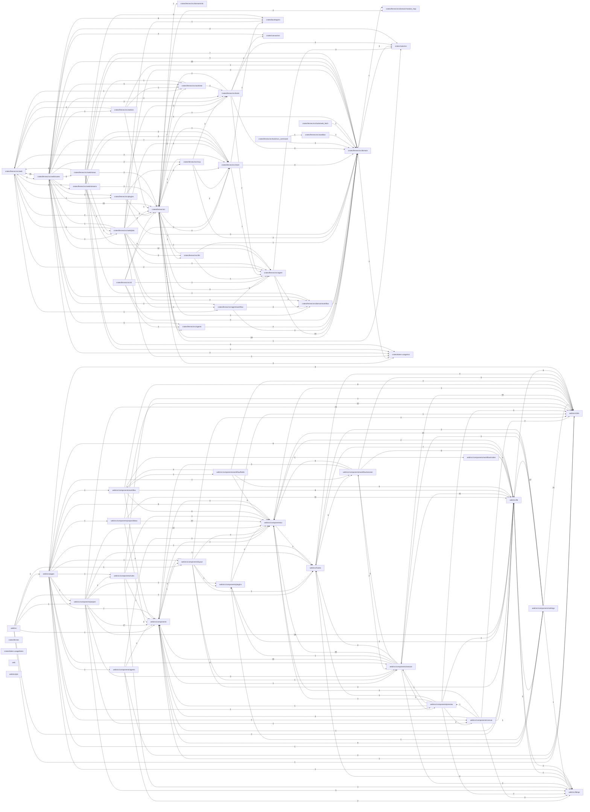

# Project map

Generated by fennec from the import lines of the source files: do not edit, regenerate it.
Each box is a module (a directory); an arrow `A --> B` means code in A imports code in B, labelled with the number of importing files.

| Module | Files | Tests | Entry point | What it is |
|---|---|---|---|---|
| `crates/fennec/src/cli` | 4 | 1 |  | Terminal adapter: run a turn in the current directory, list sessions, replay one, compact one. |
| `crates/fennec/src/tools/run_command` | 3 | 2 |  | `run_command`: a shell command run in the working directory, in the sandbox when the human enabled it; what the model reads back is `report`. |
| `crates/fennec/src/tools/web_fetch` | 5 | 5 |  | `web_fetch`: a web page fetched for the model, by pointer, not by copy: - the page is saved as a file in a cache and the model gets a short, deterministic pointer (path, size, outline, first lines), not the page: it reads the parts it needs with `read_file` or `rg`; - no `format` or `timeout` argument: always Markdown, fixed 30 s timeout; - private, loopback and link-local addresses are refused (SSRF), redirects are followed by hand so each hop is checked. |
| `crates/fennec/src/web` | 8 | 4 |  | Web adapter: the server behind the UI. std only, one thread per connection, bound to the configured address. |
| `crates/fennec/src/sandbox` | 2 | 2 |  | fennec's sandbox world for commands (bwrap on Linux, Seatbelt on macOS): what a model runs sees the system read-only, its workdir writable, the human's secrets hidden and, by default, no network. The file tools keep the in-process path guard; this only wraps commands. |
| `crates/fennec/src/web/routes` | 36 | 19 |  | The JSON API (contract: `docs/api.md`) and the UI's pages. |
| `crates/fennec/src/web/os` | 4 | 1 |  |  |
| `crates/fennec/src/web/streams` | 2 | 1 |  |  |
| `crates/fennec/src/web/views` | 8 | 8 |  |  |
| `crates/fennec/src/plugins` | 4 | 4 |  | The plugin manager: one sandboxed host per activated plugin, for the server's lifetime. Plugins are global: a host sees every session of every project. It starts hosts on demand, feeds them events, and serves the block data they emit. The core renders those blocks; a plugin never writes a session log and nothing of it runs in fennec's process. |
| `crates/fennec/src/web/jobs` | 4 | 1 |  |  |
| `crates/fennec/src` | 26 | 19 | yes | `fennec`: the composition root. Parses the command line, reads the settings and hands them to the web or terminal adapter. |
| `crates/fennec/src/agent/workflow` | 6 | 4 |  | The workflow engine: walks a run through its graph (docs/workflows.md). The path is decided by domain/workflow/run.rs; this file runs the nodes and records everything in the session's log. |
| `crates/fennec/src/domain/risk` | 2 | 2 |  | Pure risk-zone model and deterministic project risk measurements. |
| `crates/fennec/src/llm` | 3 | 2 |  | Model adapter: OpenAI-compatible endpoints (vLLM, llama.cpp, ...). |
| `crates/fennec/src/agents` | 2 | 2 |  | Agent discovery: embedded defaults, then `~/.agents/agents`, then the project's `.agents/agents`, which overrides an agent of the same id. Each agent carries where it was found (`AgentOrigin`), and the human's CRUD writes the user ones. |
| `crates/fennec/src/mcp` | 2 | 2 |  | The synchronous MCP client: JSON-RPC 2.0 over stdio (a child process in the sandbox world) and streamable HTTP (ureq). Only `initialize`, `tools/list` and `tools/call`. No async runtime: fennec is std::thread, so a hanging server is bounded by a per-call timeout that kills the child. |
| `crates/fennec/src/worktree` | 2 | 2 |  | A session's own git worktree. |
| `crates/fennec/src/store` | 8 | 8 |  | Storage adapter: the SQLite store, `projects`/`sessions`/`events`. The schema is frozen: stored logs depend on it. Implements the agent's `EventLog`. |
| `crates/fennec/src/tools` | 11 | 9 |  | The host toolbox: `read_file`, `write_file`, `edit_file` and `run_command`, plus `load_skill`, run inside one working directory, and `web_search`, which queries the human's SearXNG instance: the model only chooses the query, and `web_fetch`, which saves a page in a cache and returns a pointer to it (the model reads the parts it needs with `read_file`). Commands run in the bwrap world when the human enabled it; the file tools keep the in-process path guard. Writes to protected paths are refused; commands see them read-only. A read-only agent's commands see the workdir read-only. `canvas` shows the human a document in fennec's canvas store, never the project, so read-only agents have it too. |
| `crates/backlog/src` | 8 | 7 | yes | A fennec-free backlog of ideas. |
| `crates/fennec/src/agent` | 23 | 17 |  | The application layer: the agent loop, written against the ports in `ports` so that storage, model and tools stay replaceable. |
| `crates/canvas/src` | 6 | 5 | yes | Storage and model for canvas artifacts. |
| `crates/fennec/src/domain/workflow` | 6 | 5 |  | The workflow domain: definitions, templates, validation, and the run state folded from events. |
| `crates/fennec/src/domain` | 70 | 68 |  | fennec's vocabulary, free of storage, network and UI: what a session is made of and how its log reads back as a conversation. |
| `crates/fennec/src/domain/module_map` | 4 | 4 |  | The project map: a project's modules and the dependencies between them, read from the import lines of its source files (Rust and TypeScript or JavaScript). Deterministic: no model involved. |
| `crates/rules/src` | 7 | 6 | yes | Fennec's rule engine. |
| `crates/token-usage/src` | 5 | 5 | yes | Append-only SQLite ledger for LLM calls. |
| `web/src` | 2 | 0 | yes |  |
| `web/src/pages` | 9 | 0 |  |  |
| `web/src/components/agents` | 2 | 0 |  |  |
| `web/src/components/project` | 23 | 0 |  |  |
| `web/src/components/project/ideas` | 11 | 0 |  |  |
| `web/src/components/workflow` | 11 | 0 |  |  |
| `web/src/components/rules` | 1 | 0 |  |  |
| `web/src/components/workflow/fields` | 5 | 0 |  |  |
| `web/src/components/workflow/nodes` | 2 | 0 |  |  |
| `web/src/components` | 2 | 0 |  |  |
| `web/src/components/layout` | 4 | 0 |  |  |
| `web/src/components/plugins` | 2 | 0 |  |  |
| `web/src/components/ui` | 17 | 0 |  |  |
| `web/src/hooks` | 10 | 0 |  |  |
| `web/src/components/workflow/session` | 6 | 0 |  |  |
| `web/src/components/session` | 48 | 1 |  |  |
| `web/src/components/preview` | 6 | 0 |  |  |
| `web/src/components/canvas` | 4 | 0 |  |  |
| `web/src/lib` | 28 | 9 |  |  |
| `web/src/components/settings` | 22 | 0 |  |  |
| `web/src/lib/api` | 16 | 0 |  |  |
| `web/src/i18n` | 3 | 1 |  |  |
| `crates/fennec` | 1 | 0 |  |  |
| `crates/token-usage/tests` | 1 | 1 |  |  |
| `web` | 1 | 0 |  |  |
| `web/scripts` | 1 | 0 |  |  |
