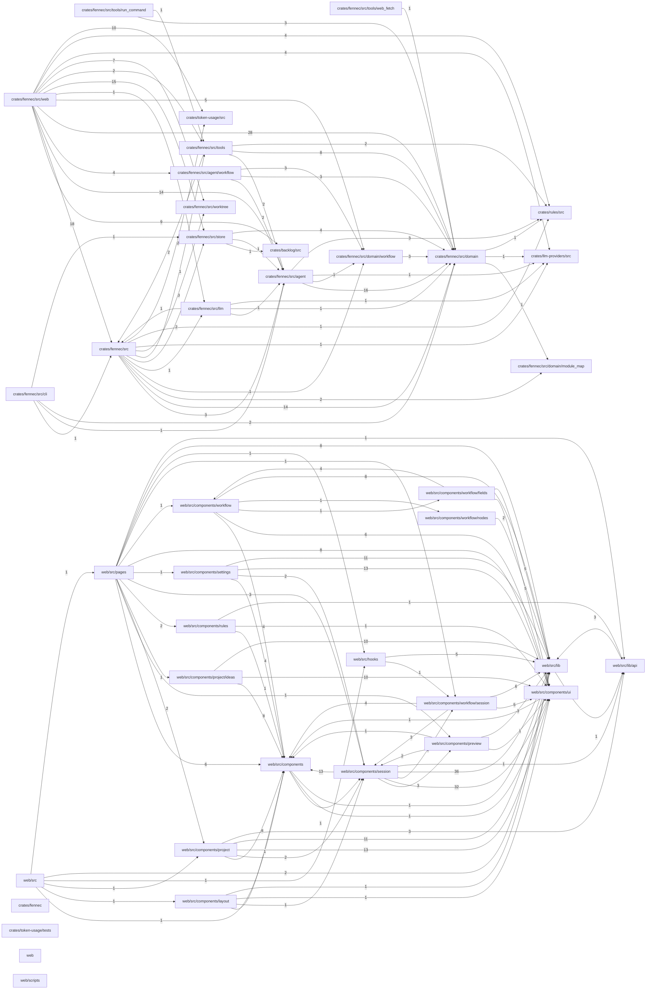

# Project map

Generated by fennec from the import lines of the source files: do not edit, regenerate it.
Each box is a module (a directory); an arrow `A --> B` means code in A imports code in B, labelled with the number of importing files.

| Module | Files | Tests | Entry point | What it is |
|---|---|---|---|---|
| `crates/fennec/src/cli` | 2 | 1 |  | Terminal adapter: run a turn in the current directory, list sessions, replay one, compact one. |
| `crates/fennec/src/tools/run_command` | 3 | 2 |  | Port of openfox `tools/shell.ts`: `run_command`. |
| `crates/fennec/src/tools/web_fetch` | 5 | 5 |  | Port of openfox `tools/web-fetch.ts`, with deliberate divergences: - the page is saved as a file in a cache and the model gets a short, deterministic pointer (path, size, outline, first lines), not the page: it reads the parts it needs with `read_file` or `rg`; - no `format` or `timeout` argument: always Markdown, fixed 30 s timeout; - private, loopback and link-local addresses are refused (SSRF), redirects are followed by hand so each hop is checked. |
| `crates/fennec/src/web` | 40 | 25 |  | Web adapter: the local server behind the UI. std only, one thread per connection, bound to 127.0.0.1. |
| `crates/fennec/src` | 20 | 17 | yes | `fennec`: the composition root. Parses the command line, reads the settings and hands them to the web or terminal adapter. |
| `crates/fennec/src/agent/workflow` | 6 | 4 |  | The workflow engine: walks a run through its graph (docs/workflows.md). The path is decided by domain/workflow/run.rs; this file runs the nodes and records everything in the session's log. |
| `crates/fennec/src/store` | 4 | 4 |  | Storage adapter: openfox's SQLite store (`db/index.ts`, `events/store.ts`), same `projects`/`sessions`/`events` schema minus the columns fennec does not use yet. Implements the agent's `EventLog`. |
| `crates/fennec/src/tools` | 11 | 9 |  | The host toolbox: openfox's `read_file`, `write_file`, `edit_file` and `run_command`, plus `load_skill`, run inside one working directory, and `web_search`, which queries the human's SearXNG instance: the model only chooses the query, and `web_fetch`, which saves a page in a cache and returns a pointer to it (the model reads the parts it needs with `read_file`). Commands run in the bwrap world when the human enabled it; the file tools keep the in-process path guard. Writes to protected paths are refused; commands see them read-only. A read-only agent's commands see the workdir read-only. |
| `crates/fennec/src/llm` | 3 | 2 |  | Model adapter: OpenAI-compatible endpoints (vLLM, llama.cpp, ...). |
| `crates/fennec/src/worktree` | 2 | 2 |  | A session's own git worktree. |
| `crates/token-usage/src` | 5 | 5 | yes | Append-only SQLite ledger for LLM calls. |
| `crates/fennec/src/agent` | 17 | 12 |  | The application layer: the agent loop, written against the ports in `ports` so that storage, model and tools stay replaceable. |
| `crates/backlog/src` | 8 | 7 | yes | A fennec-free backlog of ideas. |
| `crates/fennec/src/domain/workflow` | 6 | 5 |  | The workflow domain: definitions, templates, validation, and the run state folded from events. |
| `crates/fennec/src/domain` | 44 | 42 |  | fennec's vocabulary, free of storage, network and UI: what a session is made of and how its log reads back as a conversation. |
| `crates/fennec/src/domain/module_map` | 4 | 4 |  | The project map: a project's modules and the dependencies between them, read from the import lines of its source files (Rust and TypeScript or JavaScript). Deterministic: no model involved. |
| `crates/rules/src` | 7 | 5 | yes | Fennec's rule engine. |
| `crates/llm-providers/src` | 11 | 7 | yes | Talking to OpenAI-compatible model providers, owning the per-model parameters for a call, and sealing provider API keys at rest. |
| `web/src` | 2 | 0 | yes |  |
| `web/src/components/layout` | 1 | 0 |  |  |
| `web/src/pages` | 8 | 0 |  |  |
| `web/src/components/project` | 14 | 0 |  |  |
| `web/src/hooks` | 5 | 0 |  |  |
| `web/src/components/project/ideas` | 10 | 0 |  |  |
| `web/src/components/rules` | 1 | 0 |  |  |
| `web/src/components/settings` | 13 | 0 |  |  |
| `web/src/components/workflow` | 11 | 0 |  |  |
| `web/src/components` | 2 | 0 |  |  |
| `web/src/components/workflow/fields` | 5 | 0 |  |  |
| `web/src/components/workflow/nodes` | 2 | 0 |  |  |
| `web/src/components/session` | 39 | 0 |  |  |
| `web/src/components/preview` | 3 | 0 |  |  |
| `web/src/components/workflow/session` | 6 | 0 |  |  |
| `web/src/lib` | 14 | 0 |  |  |
| `web/src/components/ui` | 14 | 0 |  |  |
| `web/src/lib/api` | 9 | 0 |  |  |
| `crates/fennec` | 1 | 0 |  |  |
| `crates/token-usage/tests` | 1 | 1 |  |  |
| `web` | 1 | 0 |  |  |
| `web/scripts` | 1 | 0 |  |  |
