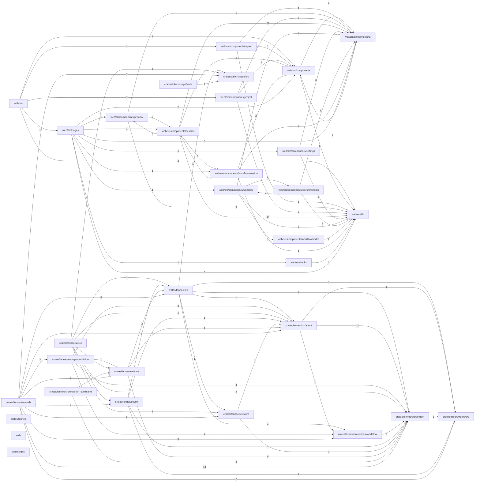

# Project map

Generated by fennec from the import lines of the source files: do not edit, regenerate it.
Each box is a module (a directory); an arrow `A --> B` means code in A imports code in B, labelled with the number of importing files.

| Module | Files | Tests | Entry point |
|---|---|---|---|
| `web/src` | 2 | 0 | yes |
| `web/src/components/layout` | 1 | 0 |  |
| `web/src/components/project` | 3 | 0 |  |
| `web/src/pages` | 5 | 0 |  |
| `web/src/components/preview` | 3 | 0 |  |
| `web/src/components/settings` | 8 | 0 |  |
| `web/src/components/workflow` | 11 | 0 |  |
| `web/src/hooks` | 1 | 0 |  |
| `web/src/components/session` | 27 | 0 |  |
| `web/src/components/workflow/fields` | 5 | 0 |  |
| `web/src/components/workflow/nodes` | 2 | 0 |  |
| `web/src/components/workflow/session` | 5 | 0 |  |
| `web/src/components` | 2 | 0 |  |
| `web/src/components/ui` | 7 | 0 |  |
| `web/src/lib` | 12 | 0 |  |
| `crates/fennec/src/cli` | 2 | 1 |  |
| `crates/fennec/src/tools/run_command` | 3 | 2 |  |
| `crates/fennec/src/web` | 22 | 12 |  |
| `crates/token-usage/tests` | 1 | 1 |  |
| `crates/fennec/src/llm` | 3 | 2 |  |
| `crates/fennec/src/agent/workflow` | 6 | 3 |  |
| `crates/fennec/src/tools` | 10 | 8 |  |
| `crates/fennec/src` | 14 | 12 | yes |
| `crates/fennec/src/store` | 3 | 3 |  |
| `crates/token-usage/src` | 5 | 5 | yes |
| `crates/fennec/src/agent` | 12 | 8 |  |
| `crates/fennec/src/domain/workflow` | 6 | 5 |  |
| `crates/fennec/src/domain` | 29 | 27 |  |
| `crates/llm-providers/src` | 8 | 6 | yes |
| `crates/fennec` | 1 | 0 |  |
| `web` | 1 | 0 |  |
| `web/scripts` | 1 | 0 |  |
