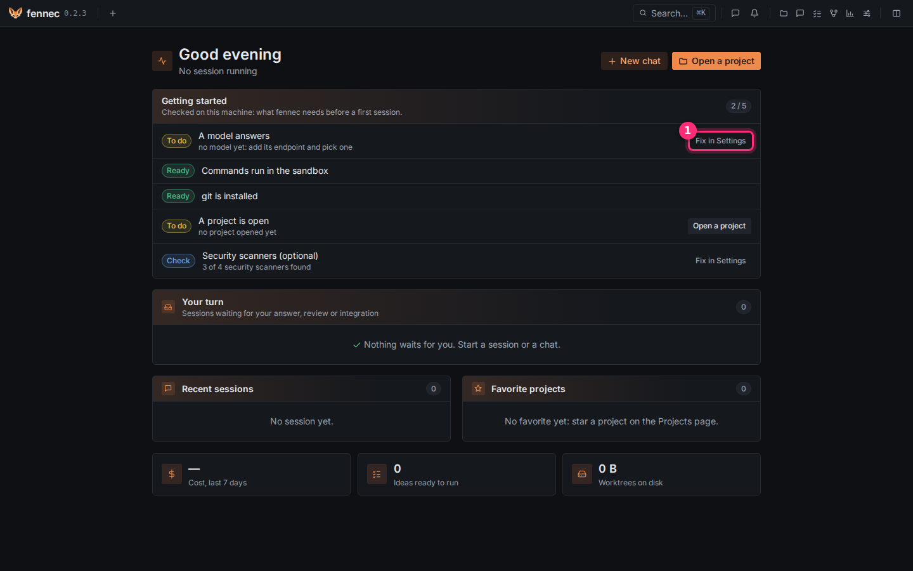
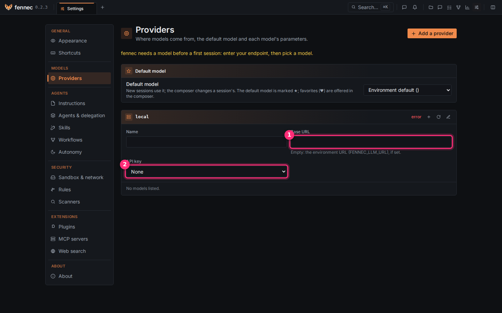
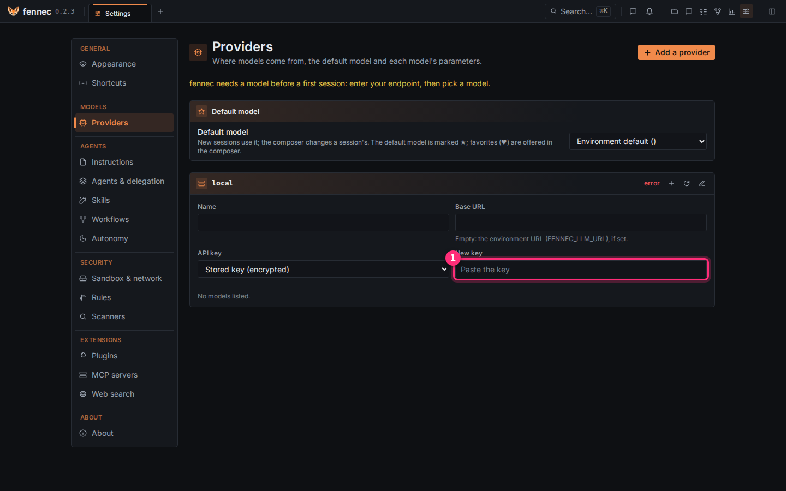
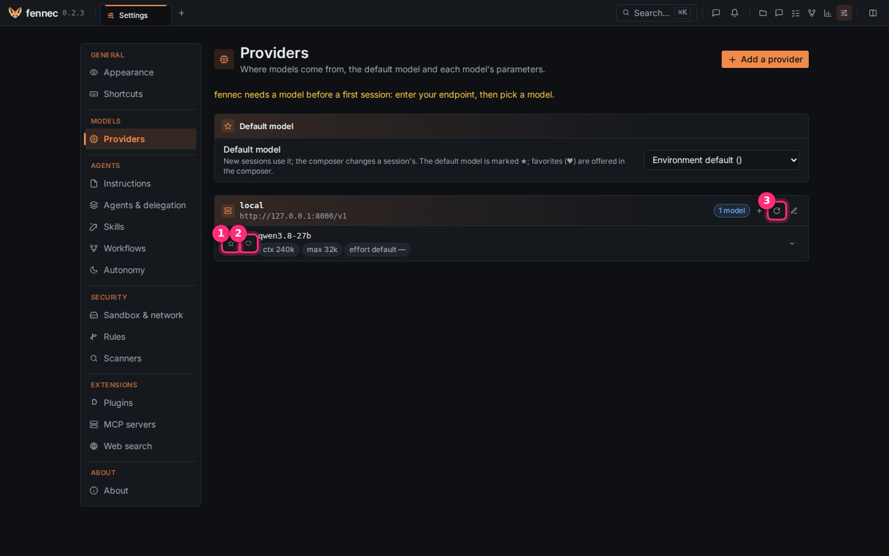
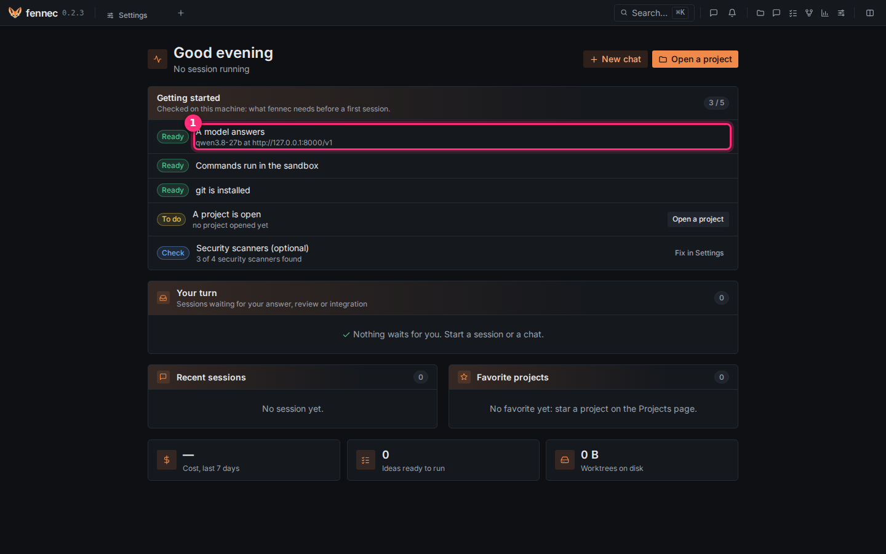

# Connect a model

fennec needs a model to work. This page connects one in five steps, about two minutes.

**Before you start**, have one of these at hand:

- **A model running on your machine** (llama.cpp, vLLM, Ollama, LM Studio…): its address, for
  example `http://127.0.0.1:8000/v1` or, for Ollama, `http://127.0.0.1:11434/v1`.
- **Or a paid provider** (OpenAI, OpenRouter, Mistral…): its address and your API key.

## Step 1: open the settings

Open fennec in your browser: <http://127.0.0.1:7777>.

The home page shows a **Getting started** card. The line **A model answers** is marked **To do**.

Click **Fix in Settings** ①.

## Step 2: type the model's address

The **Providers** page opens. It holds one card, the provider named `local`. Its first field, **Name**, already reads `local`: leave it, it only names the card. Your model's address goes in the second field, **Base URL**.

1. Click in **Base URL** ① and type your model's address, for example `http://127.0.0.1:8000/v1`.
2. Leave **API key** ② on **None** if your model runs on your machine. Go to step 4.

## Step 3: paste your API key (paid provider only)

Skip this step for a model on your machine.

1. In **API key**, choose **Stored key (encrypted)**.
2. A **New key** field appears ①. Paste your key in it.

fennec stores the key encrypted on your machine.

## Step 4: pick your model

Click anywhere outside the field. fennec saves it on its own, then lists the models your server
offers.

1. Click the star ① next to the model you want. It becomes the model of every new session.
2. Optional: click the heart ② of other models to offer them in the message box, so you can
   switch model in a session.

No model listed? Click ③ to ask the server for its list again. Still nothing: check the address
(it usually ends with `/v1`) and that your model server is running.

## Step 5: check

Go back to the home page (the fennec logo, top left).

The line **A model answers** ① is now **Ready**, with the model and its address under it.

Done. Next: [open a project](open-project.md).
