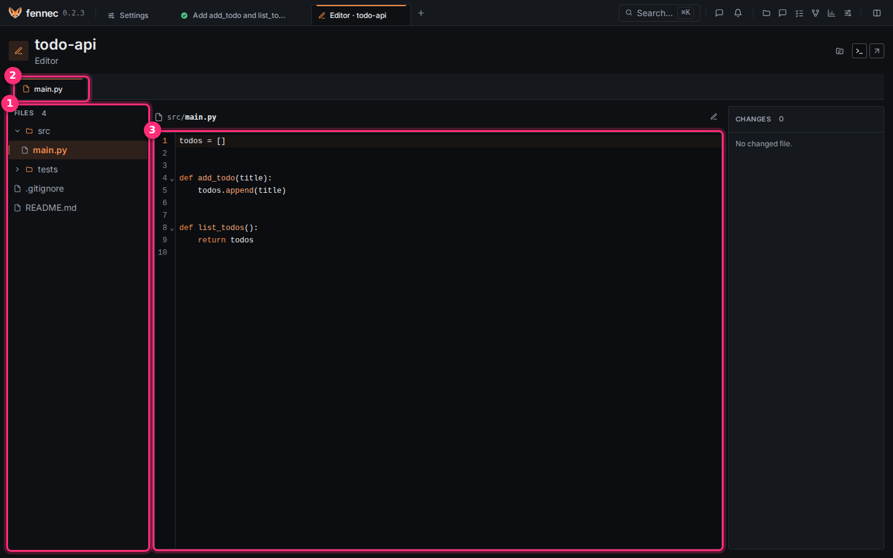
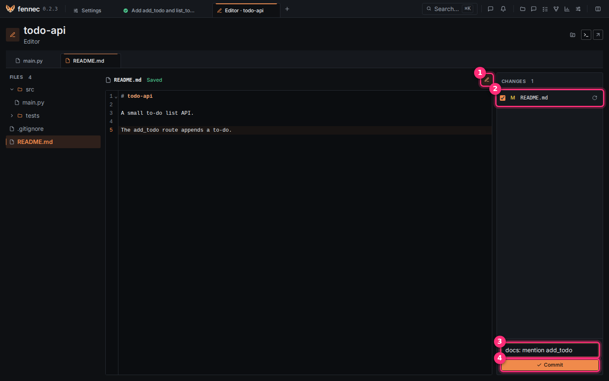

# Files and the editor

The editor reads and edits a project's files and commits the ones you pick, without leaving fennec.

## Step 1: open the editor and read a file

1. Open the project page.
2. Click **Open the editor**.

3. In the **Files** tree ①, click a file.

- The tree shows files as git sees them, ignored files are hidden, and a click on a folder unfolds it.
- Its tab ② opens in the tab strip, and several files can be open.
- The file ③ is read-only, with syntax highlighting and line numbers, and Markdown is rendered with images shown.
- **Back to the project** returns to the project page.
- Each project's editor gets its own tab in the top bar.

## Step 2: edit the file

1. Click the pencil **Edit the file** ①. It now reads **Back to reading**.
2. Type. fennec saves to disk shortly after your last keystroke and shows **Saved** next to the file name; it does not commit.

- If the file changed on disk since you opened it, the save is refused; click **Reload the file**.
- Files not tracked by git are read-only.

## Step 3: commit what you changed

1. Look at the **Changes** panel on the right of the editor.
2. Tick the changed file ② (**M** means modified).
3. Type a message in **Commit message** ③, for example `docs: mention add_todo`.
4. Click **Commit** ④.

- fennec makes one commit of the ticked files on your current branch, and the rest of your staged work stays out.
- A new file you tick is added, then committed.
- To undo a change instead, click **Reset to the last commit** on the file, then **Reset** in the confirmation.

## If something goes wrong

- **Commit** stays off: tick a file and type a message.
- The save is refused because the file changed on disk: click **Reload the file**, then edit again.
- A file is missing from the tree: it is ignored by git, larger than 1 MiB, or binary.
- **No changed file.** in Changes: nothing differs from the last commit.

---

## Reference

Fennec gives you a file explorer and an editor for a project. You can read files, edit them, commit selected changes, and open a terminal or your IDE from the project page and the editor page.

### The file explorer

Open the project page and click **Open the editor**. The editor page has the **Files** tree on the left and the **Changes** panel on the right. Use **Back to the project** to return to the project page.

The **Files** tree lists the project's files as git sees them: tracked files and new files. Ignored files are not listed. The tree is collapsible.

- Pick a file to read it.
- Markdown files are rendered while you read them.
- Images are shown as images. An SVG shows as an image in read mode and as its source in edit mode.
- Files over 1 MiB are not shown.
- Binary files are not shown.
- Only the first 20,000 files are listed.
- Untracked files are marked **Not tracked by git: read-only**.

The editor shows syntax highlighting and line numbers.

### Reading and editing

A file opens read-only. Markdown is rendered. Click **Edit the file** to switch to the source. Click **Back to reading** to return to the rendered view.

While you edit a tracked file, fennec saves it to disk shortly after your last keystroke. It does not commit it. If the file changed on disk since you read it, the save is refused and autosave stops until you reload the file. Use **Reload the file** when this happens.

Each project's editor gets its own tab in the header. Selecting that tab returns to the last file you opened in that project.

If an image cannot be shown, fennec shows **This image cannot be shown: too large or unreadable.**

### Changes and commits

The **Changes** panel lists files that differ from HEAD. It also lists new files that git does not ignore. When nothing differs from HEAD, the panel shows **No changed file.**

Tick the files you want to include in a commit. Enter a **Commit message** and click **Commit**. Fennec makes one commit of the ticked files on your current branch. It leaves the rest of your staged work out.

If you tick a new file, fennec adds it first, then commits it. If the commit fails, the new file is unstaged again.

You can reset a changed tracked file with **Reset to the last commit**. Fennec asks **Reset this file?** and you confirm with **Reset**. A new file is only unstaged and stays on disk.

### Files from a session

Report cards and the session's right panel link to files. While a session's branch has commits, they open the session's version, read-only. The page shows **Session version**. After the branch is gone, they open the working tree. Use **See your working tree** to switch.

A modified file opens the session's diff for that file while the branch has commits. The diff page links to the whole file as the session's branch has it, read-only.

Use **Open the whole file** to read the full file.

The session's **Modified files** block shows the count and a link to the session's **Changes** page. That page lists the branch's files in the [review gate](review-gate.md) order, with their signals, and shows the selected file's diff against the session's base. The diff is colored and numbered on both sides and is cut at 5,000 lines. An icon opens the whole file in the IDE you choose.

See [sessions](sessions.md) for the session view.

### Terminal and IDE

The project page header and the editor page header offer a terminal action. **Open a terminal in the project** opens your terminal in the project's folder. It runs outside the sandbox. It is your action.

In a session, the work panel offers **Open a terminal in the worktree**.

The same headers offer an open-in-IDE link. It opens the project or the agent's copy in the IDE you choose.

In [settings](settings.md), open **Appearance** and choose **IDE**. The choices are VS Code, VS Code Insiders, Cursor, Windsurf, and VSCodium. VS Code is the default. Under WSL, fennec uses the IDE's WSL remote link form.

The choice applies to the open-in-editor buttons.
