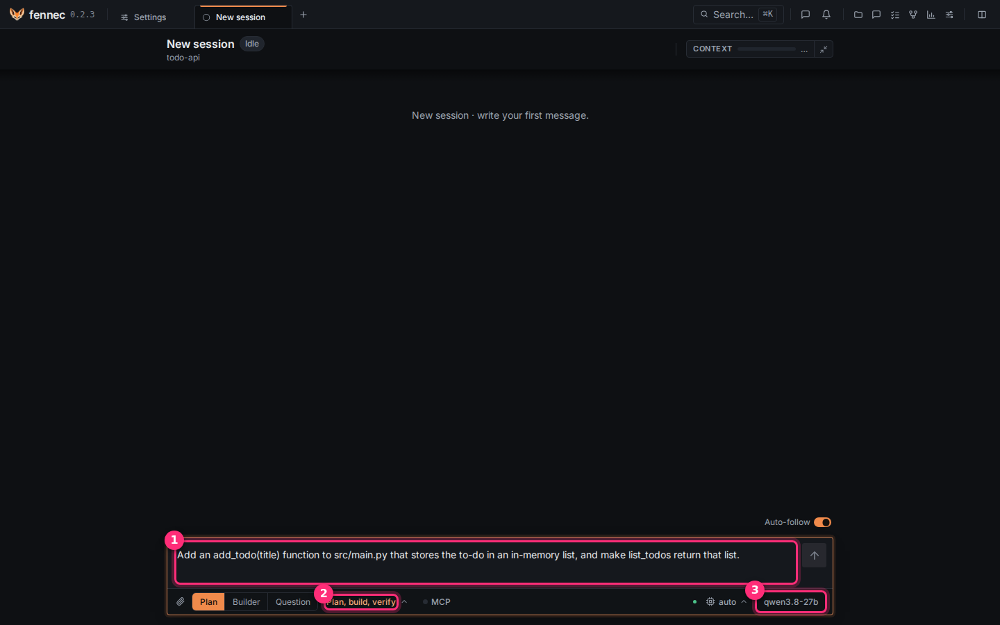
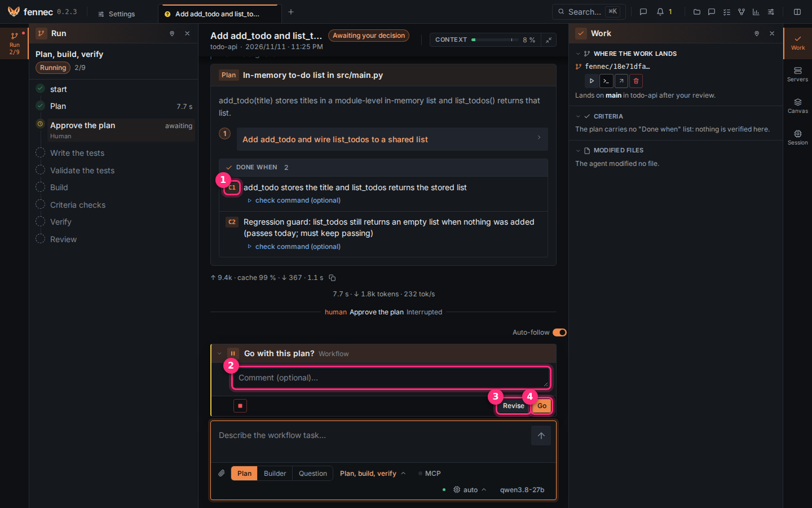
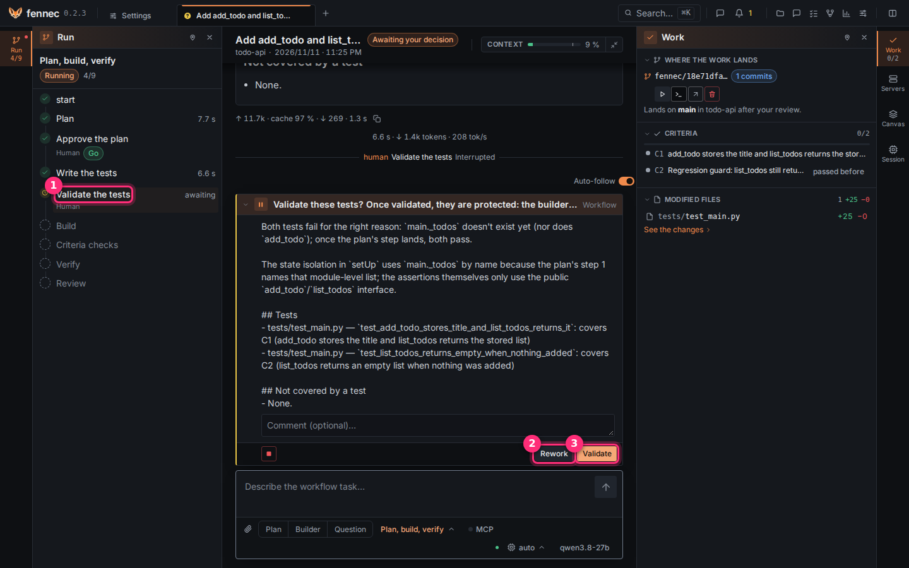
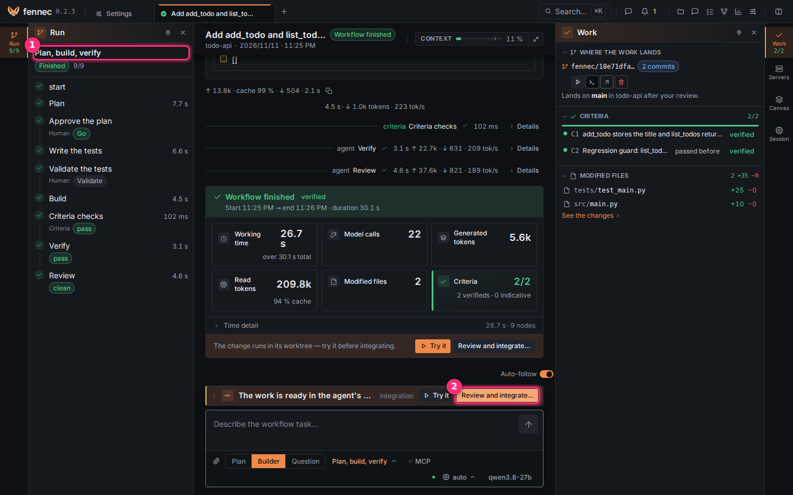
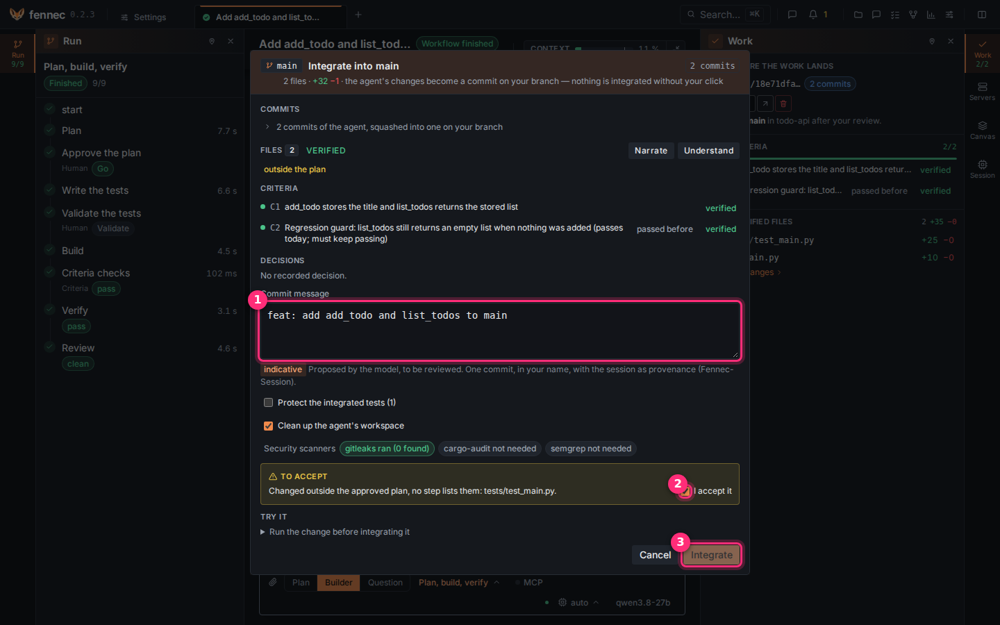
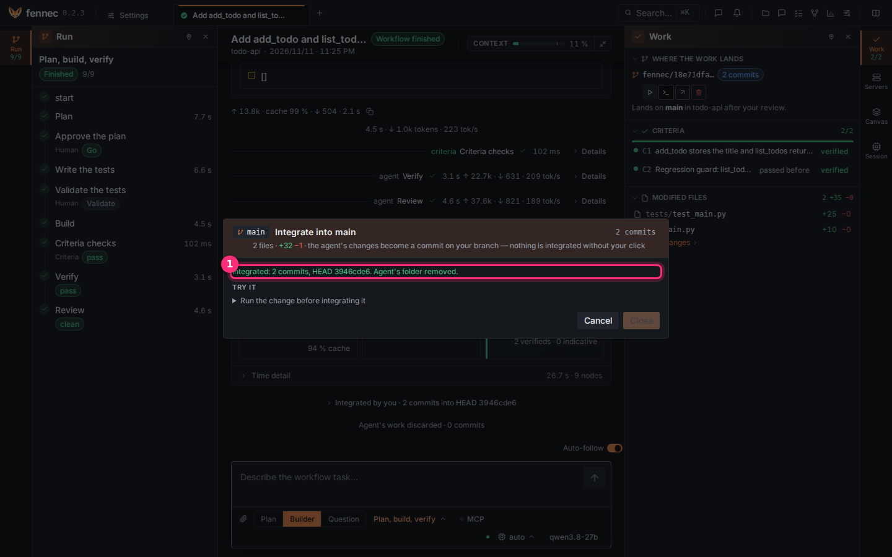

# Make your first change

fennec plans, writes the tests, builds and checks. You decide at each gate. Nothing lands on your branch without your click. This page takes about five minutes.

**Before you start**, have these at hand:

- A connected model: [connect a model](connect-model.md).
- An open project: [open a project](open-project.md).

## Step 1: ask for the change

Click **New session**.

Type the request in the message box ①.

Use this example: `Add an add_todo(title) function to src/main.py that stores the to-do in an in-memory list, and make list_todos return that list.`

The workflow ② is **Plan, build, verify**. Keep it.

③ shows the model that will answer. Click it to choose another.

Press Enter.

## Step 2: approve the plan

After a few seconds the plan appears: its steps, then **Done when** ①, the criteria that say the work is finished (C1, C2…).

Under them, **Preflight** runs each criterion's check before any work. **fails before the work** is expected: it proves the check really tests the change. It is marked **verified**: fennec ran it, no model judged it.

The question **Go with this plan?** waits for you.

Optional: type a remark in **Comment** ②.

Click **Revise** ③ to send the plan back with your comment, or **Go** ④ to start.

## Step 3: validate the tests

The agent writes the tests first ①. It writes them before any code. The left rail shows where the run is.

Read the list. Each test says which criterion it covers. **Not covered by a test** lists what is left uncovered.

Once validated, the tests are protected. The builder cannot change them without asking you. It asks for a waiver that you grant or refuse.

Not happy with them? Type a comment and click **Rework** ②. Otherwise click **Validate** ③.

## Step 4: wait for the run to finish

The agent builds. Then fennec runs the criteria checks itself. Then two agents verify and review.

The rail ① shows each step. It shows **Finished 9/9** when done.

The card at the end sums up time, model calls, tokens, modified files and criteria: **verified** means checked by fennec, **indicative** judged by a model.

The work sits in its own worktree. It is not on your branch.

**Try it** runs the change in that worktree first. It is optional.

Click **Review and integrate…** ②.

## Step 5: integrate

The dialog shows the commits, the files, the criteria and the security scanners.

The commit message ① is proposed by the model. It is marked indicative. Read it. Change it if you want.

It becomes one commit, in your name, on your branch.

A **To accept** box appears when something needs your eye. It can be a file no plan step names. Check **I accept it** ② once you agree.

Want to understand the change first? **Narrate** opens an agent that walks you through it, **Understand** one that answers your questions.

Click **Integrate** ③.

## Step 6: check

**Integrated** ① gives the commit (HEAD).

The change is on your branch. The agent's workspace is removed.

Close the dialog.

## If something goes wrong

- The plan does not suit you. Click **Revise**. Add a comment.
- A step fails. The run stops and says why. Ask again in the message box.
- You do not want the work. Delete the session from the session list. Your branch never changed.

Done. Next: [use fennec from another machine](remote-access.md), or see [ways to work](ways-to-work.md).
