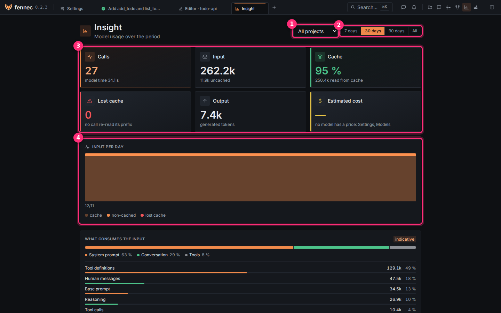

# Usage and budgets

The Insight page shows what your models consumed: calls, tokens, cache and an estimated cost. Its figures are recorded facts; only the cost is an estimate from the prices you set.

## Read your usage

Click the **Insight** icon in the top bar (the bar chart icon).

1. Choose **All projects** or one project in ①.
2. Choose **7 days**, **30 days**, **90 days** or **All** in ②.

The cards in ③ are **Calls** (with the model time), **Input** (tokens sent, with the part not served from cache), **Cache** (share of the input read from the server's cache), **Lost cache** (calls that re-read what the server had already seen, a sign the cache was evicted), **Output** (generated tokens), and **Estimated cost** (a dash until a model has a price).

**Input per day** in ④ shows one bar per day split into **cache**, **non-cached** and **lost cache**.

Below, **What consumes the input** is marked **indicative**. It shows the share of **System prompt**, **Conversation** and **Tools**, then rows such as **Tool definitions**, **Human messages** and **Reasoning**. **By project** splits the totals per project. With no call in the period the page says **No calls over the period.**

In a session, the **Session tokens** panel shows the same for that session: **Calls**, **Estimated cost**, **Last call**, **Composition**.

## Step 1: give a model its price

1. Open **Settings** > **Providers**.
2. Next to the model, click the arrow **Model parameters**.
3. Under **Price ($ per million tokens, for the Insight estimate)**, type the price per million tokens in **Input**, **Cache** and **Output**.
4. Leave **Billed** as it is.
5. Click **Save**: it appears at the top of the card once you change a value.

**Billed** is off for a local model and on for a paid provider. Only billed models count toward budgets. **Estimated cost** now shows an amount.

## Step 2: set a monthly budget for a project

1. Open the project.
2. On its page, click the tile **Set the monthly budget**.
3. Type an amount in **Monthly budget in $**.
4. Click **Save the budget**.

**Remove the budget** deletes it; **Cancel** closes the dialog without a change. At 80 % of the budget fennec raises an alert. Once the budget is exceeded, fennec refuses to start a new turn on that project until you raise or remove the budget. Your typed message stays in the composer.

## What the project measures by itself

The project's **Indicators** tab measures the project from recorded facts only: integrations, dialogues, git, and the usage ledger. It never measures what a model says. It shows, among others, AI commits made outside fennec, sensitive integrations without a comprehension dialogue, module rule breaks, the month's cost per integration, and integrations tied to an approved plan. See [Understanding the project](understanding.md) for the map and risk zones.

## If something goes wrong

- **Estimated cost** shows a dash: no model has a price. Do Step 1.
- **Lost cache** is high: another program uses the same model server and evicts fennec's cache. Give fennec its own server or a larger cache.
- A turn is refused with a budget message: raise or remove the project's budget (Step 2).
