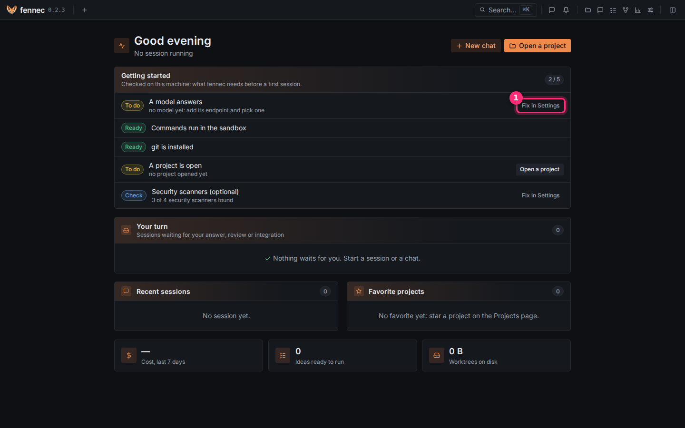

# Install fennec

fennec installs as one binary and can run as a user service. This page installs it in three steps.

**Before you start**, have one of these platforms and git:

- Linux with glibc 2.35+, for example Ubuntu 22.04 or Debian 12
- macOS on Apple Silicon or Intel
- Windows with WSL2
- git, with your name and email set: fennec commits the agent's work under your identity

  ```bash
  git config --global user.name "Your Name"
  git config --global user.email you@example.com
  ```

## Step 1: run the install script

```bash
curl -fsSL https://raw.githubusercontent.com/ikarys/fennec/main/install.sh | sh
```

The script installs the latest release into `~/.local/bin` after checking its checksum. It starts fennec in the background now and at each login.

## Step 2: install the command sandbox (Linux and WSL only)

Every command a model writes runs inside this sandbox. On Linux and WSL, install it:

```bash
sudo apt install bubblewrap
```

Use your distribution's `bubblewrap` package if you do not use apt.

On macOS, nothing to do.

On Ubuntu 23.10 or later, AppArmor can forbid the user namespaces bwrap needs; see [troubleshooting](troubleshooting.md) (the Settings page shows the command to allow bwrap).

## Step 3: open fennec

Open <http://127.0.0.1:7777> in your browser. On Windows, use the Windows browser.

The home page shows the **Getting started** card: it lists what is still missing.



> **Windows:** fennec runs in WSL2 only. For the background service, enable systemd in `/etc/wsl.conf`:
>
> ```ini
> [boot]
> systemd=true
> ```

## Update fennec

The top bar shows an arrow when a newer release is available. A click installs it and restarts the server. The update is refused while a turn runs.

You can also run:

```bash
fennec update --check
fennec update
```

## Other ways to install

With mise:

```bash
mise use -g github:ikarys/fennec
```

For the install script, you can set `FENNEC_VERSION`, `FENNEC_INSTALL_DIR`, or `FENNEC_SERVICE=none`.

If you installed fennec another way, set up the service with:

```bash
fennec service install
```

Building from source is in the technical documentation.

## Logs and the background service

| Platform | Service file | Logs | Keep running or restart |
| --- | --- | --- | --- |
| Linux | `~/.config/systemd/user/fennec.service` | `journalctl --user -u fennec -f` | `sudo loginctl enable-linger "$USER"` |
| macOS | `~/Library/LaunchAgents/dev.fennec.plist` | `~/Library/Logs/fennec.log` | `launchctl kickstart -k gui/$(id -u)/dev.fennec` |

Without a systemd user session, run `fennec serve` yourself.

Done. Next: [connect a model](connect-model.md).
