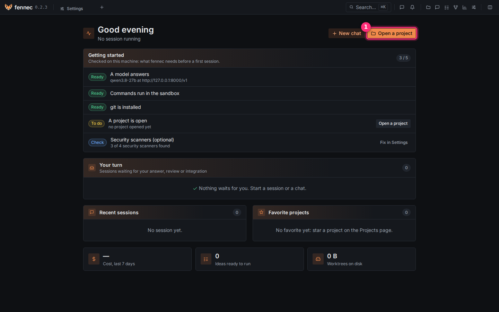
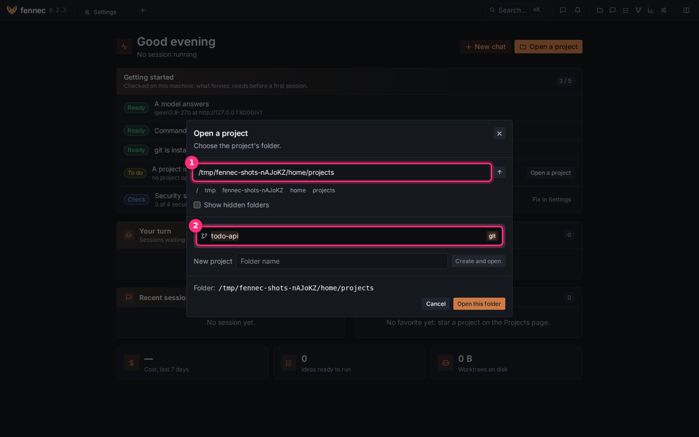
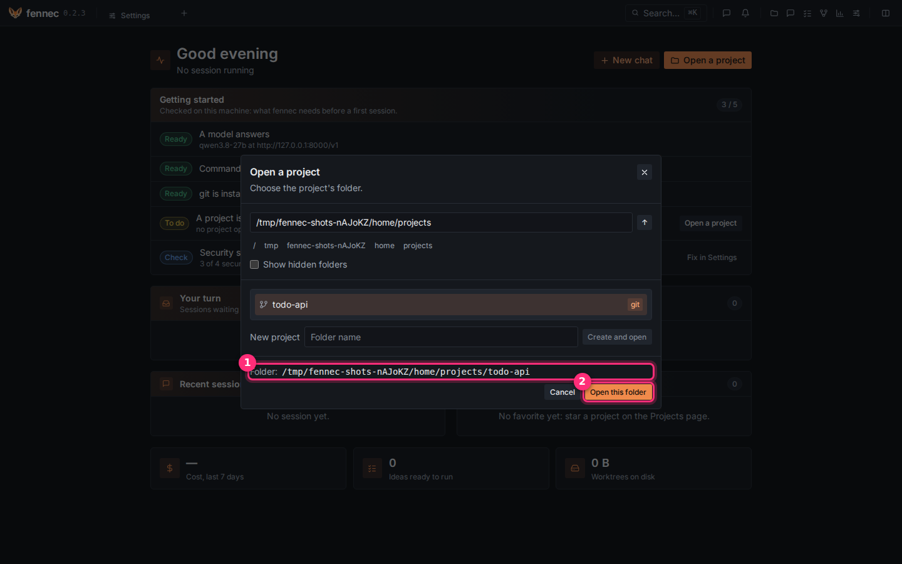
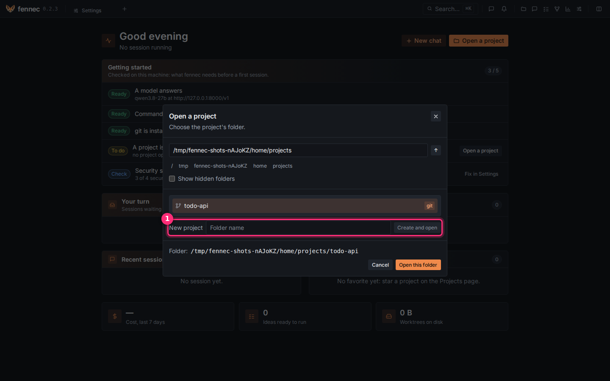
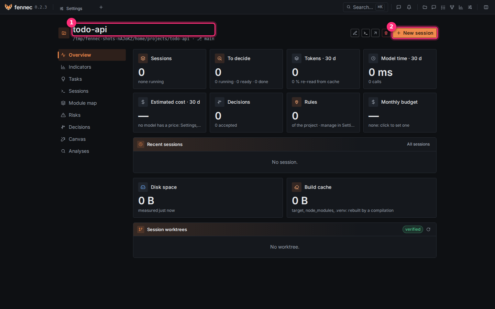

# Open a project

A project is a folder on your machine, usually a git repository. This page opens one in three steps.

**Before you start**, [connect a model](connect-model.md).

## Step 1: open the folder browser

On the home page, click **Open a project** ①.

## Step 2: find your folder

The **Open a project** window opens on your home folder.

- Type the folder's path in the field ① and press **Enter**, or
- double-click a folder to go inside it. The **↑** button goes back up.

A git repository shows a **git** badge ②. Click it once to select it.

## Step 3: open it

The **Folder:** line ① now shows the folder you selected. Click **Open this folder** ②.

> **Tip:** starting from scratch? Type a name next to **New project** ① and click
> **Create and open**: fennec creates the folder, with an empty git repository, inside the folder
> you are in.
>
> 

## Done

The project's page opens, with its name ① and its folder under it.

Next: click **New session** ② and [ask for a first change](first-session.md).
