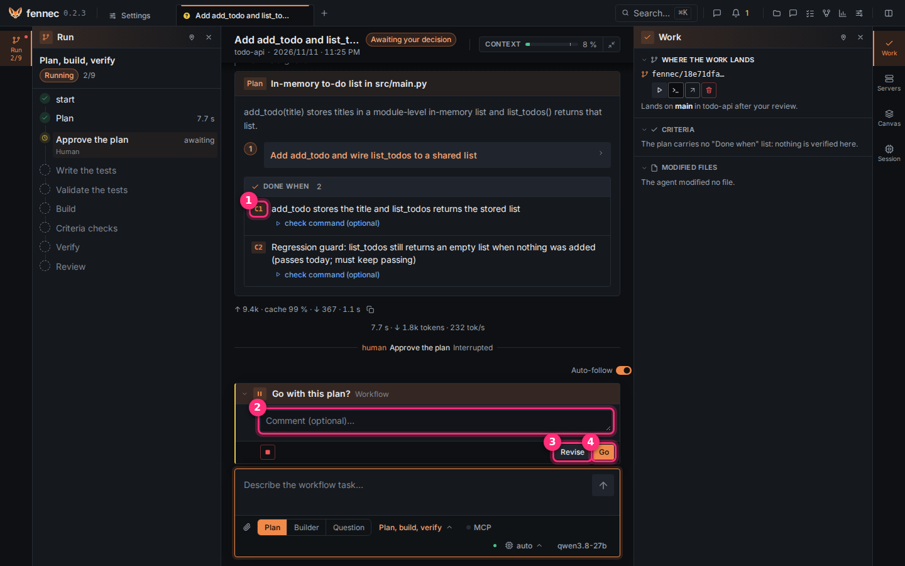
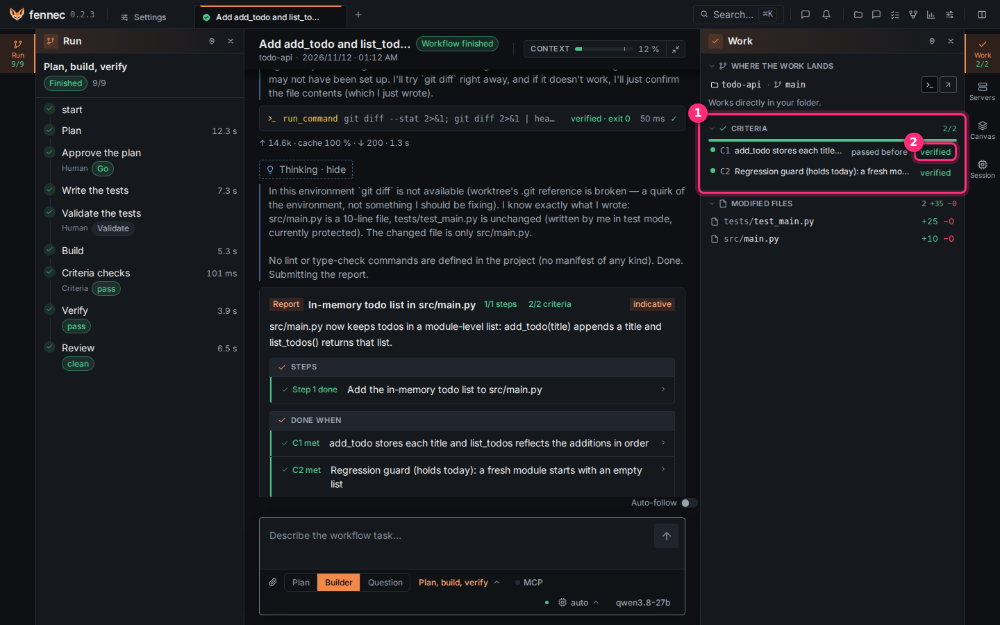
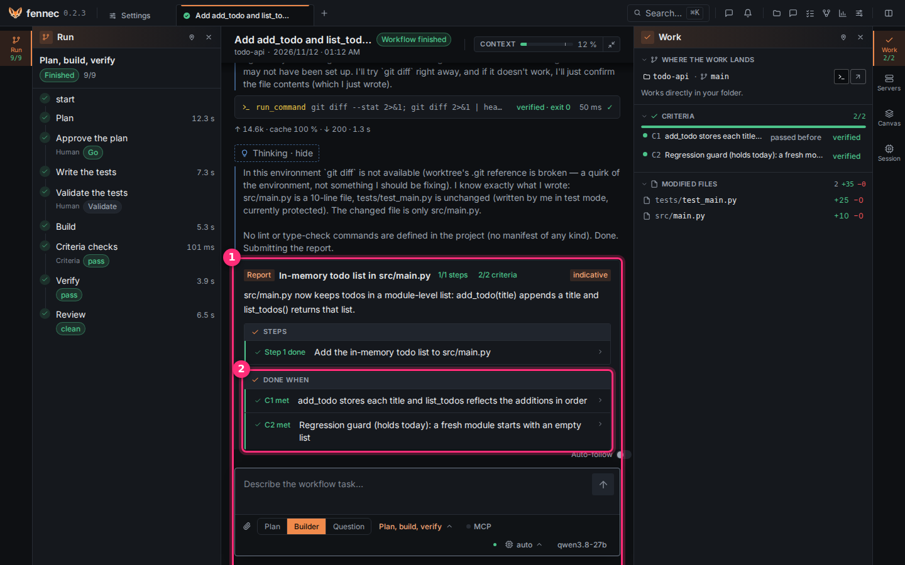

# Plans and acceptance criteria

A plan says what the agent will do and, in **Done when**, how you will know it is finished. You approve it before any code is written, and fennec checks its criteria itself.

## Step 1: get a plan

1. Open a project.
2. Click **New session**.
3. Keep the workflow **Plan, build, verify**, or pick the agent **Plan** with **No workflow** to only discuss the plan.
4. Describe the change: what and why.
5. Press `Enter`.

The plan agent reads the code but changes nothing. Before the plan, it talks with you: what it found, the options, the one it recommends, and its questions. Answer it until you agree on the approach; only a small change with one obvious way to do it, or a task sheet, gets a plan straight away.

## Step 2: read and approve it



The plan card shows the steps, then **Done when** ①: the acceptance criteria C1, C2… A criterion can carry a check command, a shell command that exits with 0 once the criterion holds (for example `.venv/bin/python -m pytest -q`; it runs in the sandbox, in the session's worktree, with no network); a criterion with a check is **verified** by fennec, one without is judged by an agent and stays **indicative**. **Preflight** runs each check before any change: **fails before the work** is what you want; **already passes** proves nothing and goes back to the planner.

1. Optional: type a remark in **Comment** ②.
2. Click **Revise** ③ to send the plan back with your remark, or click **Go** ④ to start the build.

## Step 3: follow the criteria during the build



Open the **Work** tab of the rail on the right.

**Criteria** ① lists each criterion with its count (here 2/2) and what happened: **passed before** means its check already passed before any change: it guards against a regression but does not prove the new work. ② The badge **verified** means fennec ran the check itself; **indicative** means a model judged it.

A model verdict never overrides a **verified** check.

## Step 4: read the report



When the build ends, the **Report** card ① replaces the plan in the thread: the steps the builder says it did, with the **indicative** badge since a model wrote it. **Done when** ② shows each criterion as **met** or not.

1. Check the criteria marked **verified** first.
2. Review the changes at [the review gate](review-gate.md).

## If something goes wrong

- **already passes** in **Preflight**: the check does not test the change. Click **Revise** to ask for a stricter check.
- **cannot run here**: the check needs something the sandbox lacks (network, a service). Fix the command or drop the check.
- The work touched files the plan did not list: the review gate shows them as **outside the plan**. You decide.

---

## Reference

### How a plan is made

You start a session on the **Plan** agent, or open a plan session from an idea in [tasks](tasks.md). The plan agent is read-only: it explores the codebase, discusses the approach with you, then proposes a plan, but it changes nothing.

The plan card in the thread shows **Steps**, **To test**, **To do**, and **Risks** when the agent includes them. Use **Revise** to keep working on the plan with the agent.

### The Done when list

The **Done when** list is the acceptance criteria for the run. Each bullet can carry a check command:

```text
— check: <command>
```

A check must hold for any correct implementation of the work, not for one implementation. It must also run in the sandbox, where the main repository is read-only. If a builder cannot pass a check for those reasons, it proposes a corrected list and you decide. In night mode, the proposed change is recorded as a decision for you to review, and the work goes on against the approved criteria.

Criteria without a check are judged by an agent and marked **indicative**.

### Preflight

Before the build, fennec runs the plan's checks in the **Preflight** section. The section is marked **verified** because fennec ran the commands itself before any change.

Preflight results tell you what the baseline proves:

- **fails before the work**: expected, because the criterion is not met yet.
- **already passes**: proves nothing about the upcoming change, so it is sent back to the planner.
- **cannot run here**: an environment problem, also sent back to the planner.

### Launching the build

From the plan card, **Launch** starts the **Plan, build, verify** workflow: criteria are checked, the result is verified in a fresh context, and the diff is reviewed. See [workflows](workflows.md).

**Builder alone, without criteria or review** starts a build without the full gate. **Save to backlog** keeps the plan in the project backlog without launching it now.

The build normally works in a copy of the repository, a git worktree, so you integrate afterwards. If the session works directly in your folder, nothing separates the agent's work from yours.

### Builder report

After the build, the **Report** card lists the **Steps** the builder says it took. The report is **indicative**: its checks are declared by the model, not verified by fennec.

fennec's own criterion checks and fresh-context verification are separate. When fennec computes a result, it is marked **verified**.

### Verdicts and provenance

A criterion with a `check:` command is run by fennec and recorded as **verified**.

A criterion without a check can be judged by an agent node with verdicts. Lines such as `C1: pass — <why>` or `C2: fail — <why>` are recorded as that criterion's status and marked **indicative**. A model verdict never overrides a verified check.

Use **verified** for facts fennec computed deterministically. Use **indicative** for model judgments you still need to review.

### Plan scope

The approved plan lists the files or steps the work should touch. The integration gate compares the branch's files with that scope. Files no step lists become an **outside the plan** signal and a blocker in the [review gate](review-gate.md#plan-scope).

The plan is a contract: the agent can propose more, but you decide what enters your branch.
