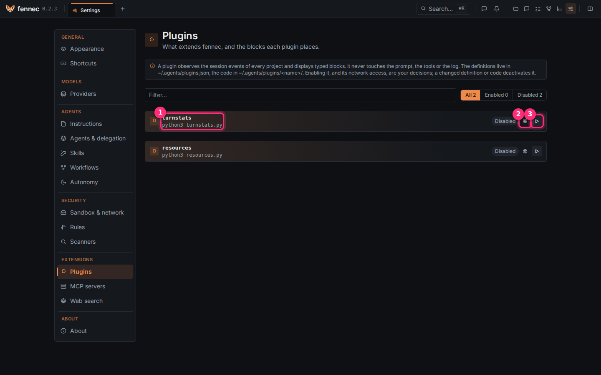
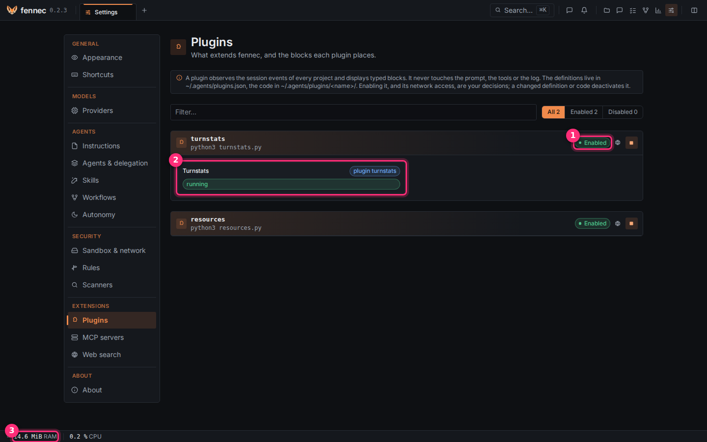

# Write a plugin

A plugin is your own small program that watches fennec and shows results in blocks. It only observes: it never changes the prompt, tools, agent, or history. This page builds one in four steps: a plugin that counts the tools each session calls.

## What a plugin can show

A plugin shows **blocks**. A block is a small card made of elements: text, figures (a label and a value), badges, lists, progress bars, links, tables. Each element can have a tone: `info`, `success`, `warning`, `danger`. Each block has a **scope** (whose data it is) and a **placement** (where it shows).

| Scope | Placement | Where it shows |
|---|---|---|
| `session` | `panel` (default) | the **Plugins** tab of the session's side panel (the panel on the right of a session) |
| `session` | `own_panel` | a tab of its own in the session's side panel, with the plugin's icon |
| `session` | `status_bar` | the status bar at the bottom, while that session is on screen |
| `project` | `dashboard` (default) | a section of the project's page |
| `project` | `status_bar` | the status bar, while a page of that project is on screen |
| `global` | `settings` (default) | **Settings** > **Plugins**, under the plugin |
| `global` | `status_bar` | the status bar, on every page |

The status bar appears only while a block is placed in it.

## What a plugin listens to

A plugin chooses the events it wants to hear: these are fennec's hooks. It names them when it starts. It can only watch: an event is a copy of what happened, sent after the fact.

| Event | Sent when |
|---|---|
| `tool.call` | an agent calls a tool (its name is in `data.toolCall.name`) |
| `tool.result` | the tool finished |
| `message.done` | the model finished a message (with its token counts) |
| `chat.done` | a turn ended |
| `workflow.node.finished` | a workflow step finished |
| `criterion.updated` | an acceptance criterion passed or failed |
| `decision.recorded` | an agent recorded a decision |
| `integration.applied` | you integrated a session's work |

The full list is in the [API reference](https://github.com/ikarys/fennec/blob/develop/docs/devs/api.md). A session's history from before the plugin started is not sent again.

## Step 1: write the code

1. Create the folder `~/.agents/plugins/turnstats/`.
2. In it, create `turnstats.py`.
3. Put this code in it:

```python
import collections, json, sys

counts = collections.defaultdict(collections.Counter)

def send(message):
    sys.stdout.write(json.dumps(message) + "\n")
    sys.stdout.flush()

for line in sys.stdin:
    msg = json.loads(line)
    if msg.get("method") == "init":
        send({"jsonrpc": "2.0", "id": msg["id"], "result": {"wantedEvents": ["tool.call"]}})
        send({"jsonrpc": "2.0", "method": "block.update", "params": {"block": "status",
              "content": {"elements": [{"kind": "badge", "label": "running", "tone": "success"}]}}})
    elif msg.get("method") == "event":
        params = msg["params"]
        name = json.loads(params["event"])["data"]["toolCall"]["name"]
        counts[params["sessionId"]][name] += 1
        elements = [{"kind": "figure", "label": tool, "value": str(n), "tone": "info"}
                    for tool, n in counts[params["sessionId"]].most_common()]
        send({"jsonrpc": "2.0", "method": "block.update", "params": {
              "block": "tools", "session": params["sessionId"], "content": {"elements": elements}}})
```

- fennec writes one JSON message per line on the plugin's input. The plugin answers one JSON message per line on its output.
- At `init`, it answers within 5 seconds with the events it wants (`wantedEvents`).
- Each `block.update` replaces the whole content of one block. `session` names the session for a session block. A `project` field names a project block. A global block has neither.

## Step 2: declare it

1. Open or create `~/.agents/plugins.json`. It is a list, with one entry per plugin.
2. Add this entry:

```json
[
  {
    "name": "turnstats",
    "command": "python3",
    "args": ["turnstats.py"],
    "icon": "activity",
    "blocks": [
      { "id": "status", "title": "Turnstats", "scope": "global" },
      { "id": "tools", "title": "Tool calls", "scope": "session" }
    ]
  }
]
```

- `name` is the folder name. It uses letters, digits, `-`, `_`.
- `command` and `args` start the plugin. They run from its folder.
- `icon` is the icon of its own tab. Choose from: `activity`, `alert`, `bell`, `branch`, `check`, `clock`, `cpu`, `eye`, `file`, `globe`, `layers`, `server`, `terminal`, `tokens`, `puzzle` (default).
- `blocks` lists every block it may show. Each block has an `id`, a `title`, a `scope`, and an optional `placement`.
- A block not listed here is never shown.

## Step 3: enable it

Open **Settings** > **Plugins**.



1. Find the plugin ①. It shows its name and its command. It shows **Disabled**.
2. Leave **Network** ② off. It is off by default. The plugin has no network. Turn it on only if the plugin needs it.
3. Click **Enable** ③.

## Step 4: see its blocks



- ① **Enabled**: the plugin runs.
- ② Its global block, **Turnstats**, shows a **running** badge.
- ③ A block placed in the status bar. Here a second example plugin, `resources`, shows fennec's own memory and CPU.

Now open a session and let the agent work. The session's side panel gets a **Plugins** tab with the **Tool calls** block: one figure per tool.

To try `resources`:

1. Copy the `examples/plugins/resources/` folder of the fennec repository to `~/.agents/plugins/resources/`.
2. Add the entry of its `plugin.json` to your `plugins.json`.
3. Enable it.

## What a plugin may do

- It always runs in the sandbox: its folder read-only, a private scratch folder and `/tmp`, no project files, no network unless you turned it on.
- If the sandbox is missing, plugins do not run.
- Changing its command, arguments or environment in `plugins.json`, or any file in its folder, disables it until you enable it again: fennec fingerprints them. Moving a block or changing the icon does not.
- An agent can never install or enable a plugin. Only you can.
- What a plugin prints on its error output is discarded.
- Limits: 200 elements and 32 KiB per block, 16 blocks. A link must start with `http://` or `https://`. An update beyond the limits is dropped.

## If something goes wrong

- Nothing shows: check that the block's `id` is listed in `plugins.json`. Check that the plugin answers `init` within 5 seconds.
- The plugin turned **Disabled** on its own: you changed its code or its definition. Click **Enable** again.
- A block stays empty: the plugin must flush its output after each line. In Python, use `sys.stdout.flush()`.
- Test the script alone: run `echo '{"jsonrpc":"2.0","id":1,"method":"init","params":{}}' | python3 turnstats.py` in its folder. It must print its answer.

Going further: the full protocol is in the [developer guide](https://github.com/ikarys/fennec/blob/develop/docs/devs/plugins.md).
