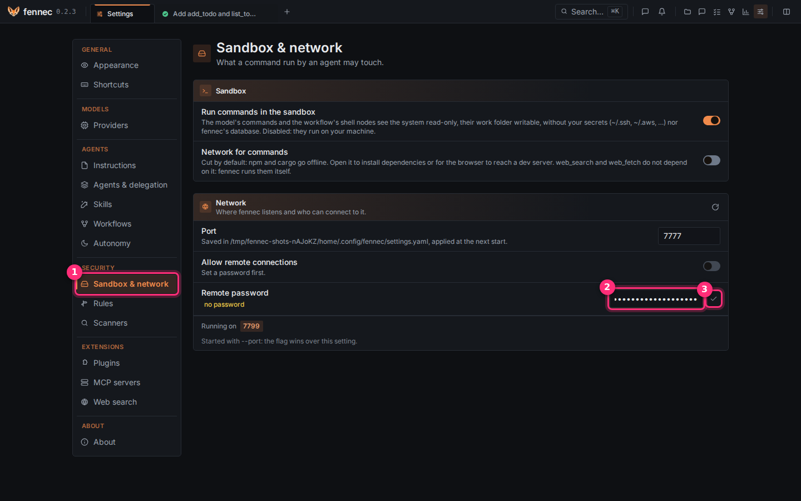
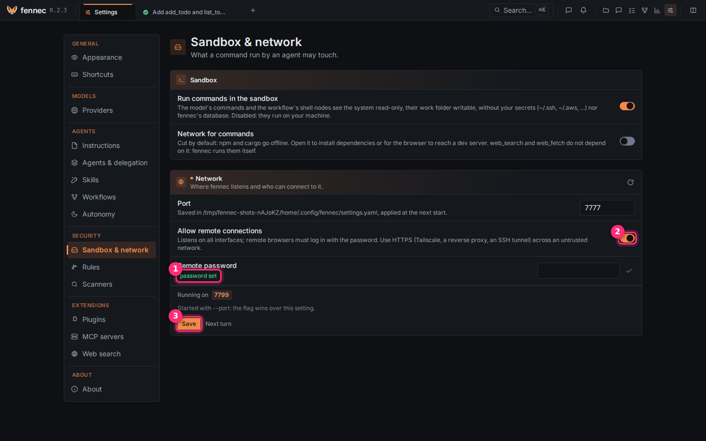
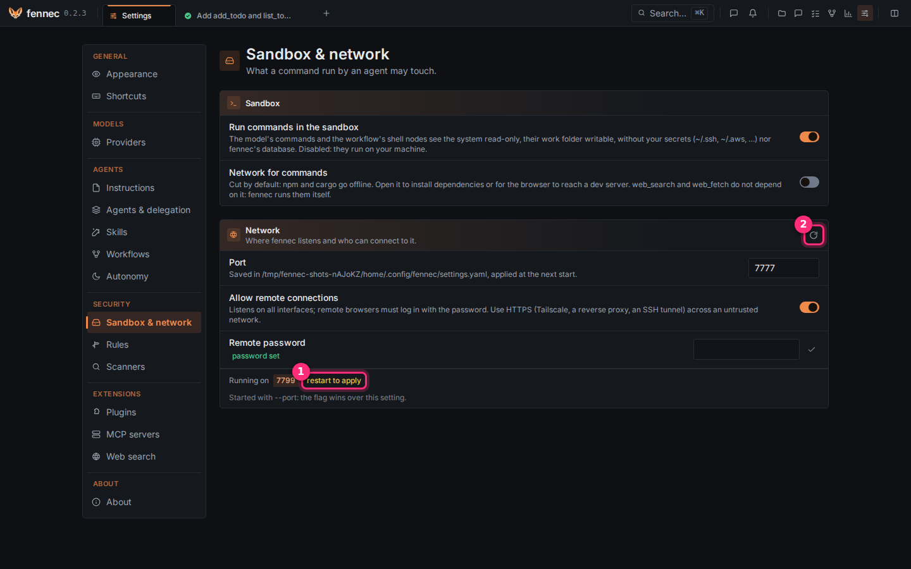

# Use fennec from another machine

By default, fennec only answers on this machine, with no password. To reach it from another machine (a laptop, a phone, fennec on a server or a NAS), give it a password and open it to the network. Two minutes.

> **Warning:** fennec speaks plain HTTP: across a network you do not trust, put it behind TLS (see "Keep it safe" below). The simplest choice needs no password at all: an SSH tunnel.

## Step 1: set a password

Click the gear (Settings). Click **Sandbox & network** ① in the left list, under Security.

In the **Network** card, type a password in **Remote password** ②. Click the check mark ③ to save it.



## Step 2: allow remote connections

The badge now reads **password set** ①. Turn on **Allow remote connections** ②. It stays off until a password is set. A **Save** button ③ then appears at the top of the card: click it.



## Step 3: restart the server

The **restart to apply** badge ① appears. Click the restart button ② at the top right of the card. Confirm.

The page comes back on its own when the server is up again.



## Step 4: connect from the other machine

Open `http://<the machine's address>:7777` there. A login page asks for the password.

You stay logged in for 30 days, until fennec restarts. Browsers on the fennec machine itself never log in.

## From a shell instead

```bash
fennec remote enable      # asks for a password if none is set, then listens on 0.0.0.0
fennec service restart    # applies it
fennec remote status      # shows the state
fennec password           # changes the password
fennec remote disable     # back to 127.0.0.1 (restart to apply)
```

fennec refuses a non-local address without a password.

## Keep it safe

**SSH tunnel**

```bash
ssh -L 7777:127.0.0.1:7777 nas
```

Then use `http://127.0.0.1:7777` in your browser. No remote password is needed because the connection stays local to the tunnel endpoint.

**Tailscale**

Run fennec on a machine in your Tailscale network and open its Tailscale address. Tailscale provides the encrypted path.

**Reverse proxy**

Use a reverse proxy that terminates TLS and passes the original `Host`. Caddy does this by default:

```caddyfile
fennec.example.lan {
    reverse_proxy 127.0.0.1:7777
}
```

nginx needs:

```nginx
proxy_set_header Host $host;
```

## What stays on the fennec machine

The play button's servers and the preview stay on `127.0.0.1`. Use an SSH tunnel for them.

To close it again: turn **Allow remote connections** off, **Save**, restart (or `fennec remote disable`).
