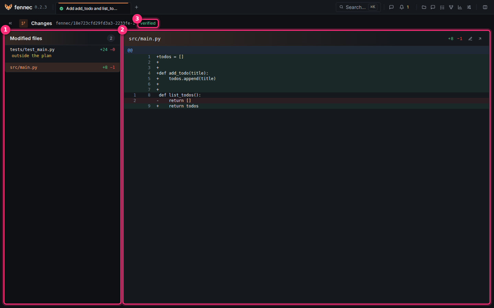
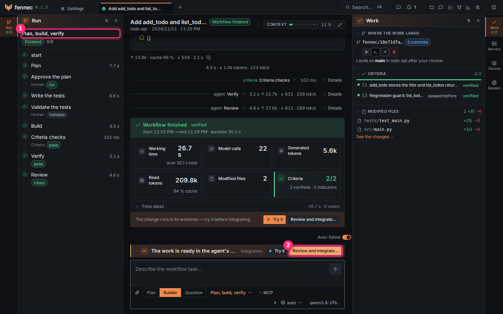
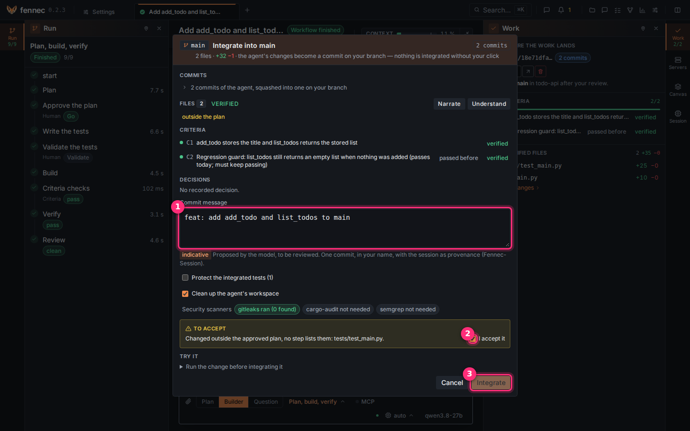
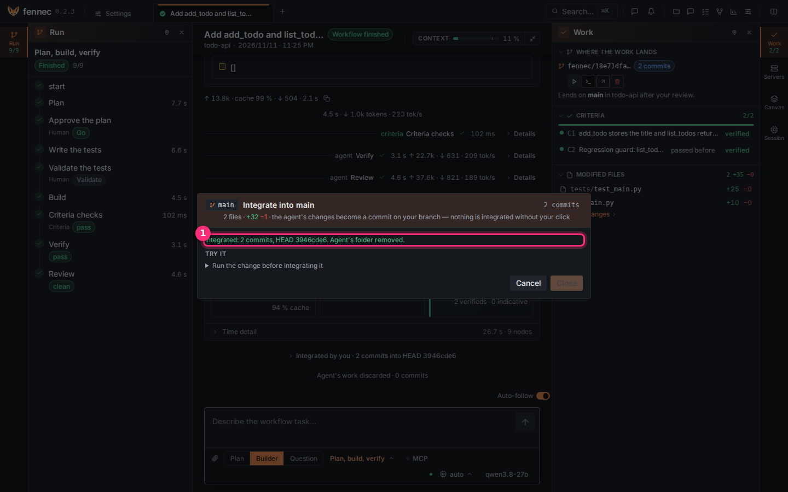

# The review gate

The agent's work waits in its own git worktree, never on your branch. The review gate is where you read it and decide: integrate it as one commit in your name, or discard it.

## Step 1: read the changes

When a run finishes, open the **Work** tab of the session's right rail and click **Changes** next to **Modified files**.



- ① **Modified files** lists the branch's files, the riskiest first, with their signals: here **outside the plan** (a file no plan step names).
- ② The diff shows the selected file against the point the session started from: green lines added, red lines removed. The pencil opens the file; the arrow opens it in your IDE.
- ③ **verified**: the list and the signals are computed by fennec, not by a model.

Click each file and read its diff.

## Step 2: open the integration

Back in the session, the end card sums up time, calls, tokens, files and criteria.



Optional: **Try it** runs the change in the worktree first (see Try the change below).

Click **Review and integrate…** ②.

## Step 3: accept what needs your eye, then integrate

The dialog shows the commits, the files, the criteria and the security scanners.



1. Read the commit message ①. A model proposed it, so it is marked indicative. Change it if you want.
2. If a **To accept** box appears, read each item (a protected file, a sensitive zone, a file outside the plan, a weakened test…). Tick **I accept it** ② for each one you agree with. **Integrate** stays off until every item is accepted.
3. Optional: **Narrate** opens an agent that walks you through the change, **Understand** one that answers your questions.
4. Click **Integrate** ③.

## Step 4: check the result

**Integrated** ① gives the new commit on your branch (HEAD).



The agent's worktree and branch are removed. Your repository's hooks never run during this: fennec disables them.

## Not convinced? Discard it

In the **Work** tab, under **Where the work lands**, **Discard this work** deletes the agent's worktree, branch and commits. Your folder and your branch are not touched.

Or answer the agent in the session to ask for a change before you integrate.

## If something goes wrong

- **Conflict with your branch**: your branch changed the same lines since the run started; see Conflicts below.
- **Uncommitted changes would be overwritten**: commit or stash your own changes in those files. Then integrate.
- **Integrate** stays off: an item in **To accept** is not ticked yet.

---

## Reference

### The Changes page

The session panel's **Modified files** block links to the **Changes** page. The page lists the branch's files in the same order the gate reviews them, with their signals.

Selecting a file shows its diff against the session's base, the range the integration takes. Diffs are colored and numbered on both sides and cut at 5,000 lines. **Open in VS Code** opens the whole file in your editor.

### What blocks an integration

The gate can block integration for any of these reasons:

| Blocker | Meaning |
| --- | --- |
| **No commits to integrate.** | The branch has no commits to take. |
| **Conflict with your branch** | Your branch changed the same lines since the run started. |
| **Criteria not passed** | One or more checked criteria failed. |
| **No criteria** | Nothing was verified. |
| **Protected files changed** | A protected file was touched. |
| **Sensitive zones changed** | A sensitive zone changed and your review is mandatory. |
| **Changed outside the approved plan** | A file is not listed by any step of the approved plan. |
| **A sensitive zone changed and no comprehension dialogue was held** | The branch changed a sensitive zone without a comprehension dialogue on this version. |
| **Security scanners flagged** | A scanner found a problem. |
| **The security scanners are still running** | Scanner results are not in yet. |
| **Architecture rules violated** | An added line breaks an architecture rule. |
| **Checks disabled in added lines** | Added lines silence a lint, type check, or test. |
| **Weakened tests** | Tests or assertions were removed on balance. |
| **The run started from** | Your branch moved, including a detached HEAD, so the commits would go elsewhere. |
| **Uncommitted changes would be overwritten** | Your folder has uncommitted changes in files the integration would touch. |

You accept each blocker one by one with **I accept it**. The **To accept** list shows what remains.

### File signals

The review map lists the branch's files riskiest first. Each file can carry signals:

- **sensitive zone**
- **outside the plan**
- **bypass**
- **architecture**
- **conflict markers**
- **weakened tests**
- **validated tests**
- **artifact**
- **often modified**
- **no own test**
- **large change**

Signals are computed from git and the gate's checks where possible. They help you read the diff in the right order.

### Protected files and waivers

Protected files include fennec's defaults (`.agents`, `AGENTS.md`/`CLAUDE.md`, lockfiles in your checkout, CI config, `.githooks`, accepted ADRs in `docs/adr`) and the paths in your project's `.agents/protected`.

File tools refuse protected files, and the sandbox mounts them read-only. If an agent needs a protected file, it asks for a **Waiver**. The card shows the path and the **Reason (indicative)**. You choose a **Waiver duration** of 1, 8, or 24 hours, then **Grant** or **Refuse**.

A grant exempts exactly that path, in that session, until it expires. fennec writes a MADR file to the session's `docs/adr/`, and that file goes with the branch to the gate. With you away, a waiver request is refused.

### Architecture rules and drift

`.agents/architecture` rules are checked on the lines an integration adds. A violation is a blocker.

Module rules, such as `<A> never imports <B>`, are checked against the project map. The project's **Module map** shows breaks and drift since `docs/map.md`. `sensitive <pattern>` lines in the same file mark paths where your review is mandatory.

### Plan scope

The gate reads the `Files:` lines of the run's approved plan. The test files you validated at the test gate count as listed: they carry a **validated tests** signal instead. A branch file no step lists gets an **outside the plan** signal and a **Changed outside the approved plan** blocker. You accept it if the extra file is justified.

### Security scanners

The gate runs the security scanners it finds on `PATH` in the read-only sandbox without network:

- `gitleaks` on the branch's commits
- `cargo-audit` when `Cargo.lock` changed
- `semgrep` with your own `.semgrep.yml` on the changed files

Each finding is a **Security scanners flagged** blocker. A scanner that is missing or failing is shown as a status line. The scanners run in the background, and **Integrate** is refused until they end.

### Comprehension dialogue

The **Understand** button opens a read-only dialogue about the branch. The agent asks you two or three questions, explains what you missed with `path:line` sources, and checks again. It is not an exam and gives no score.

A dialogue is mandatory when a sensitive zone changes. If one is missing, the gate shows the blocker **A sensitive zone changed and no comprehension dialogue was held on this version of the branch**.

You can also hold a comprehension dialogue on any part of the project from the project page; see [understanding](understanding.md).

The **Narrate** button opens a read-only agent that tells the change file by file in the review order. Its account is **indicative**.

### Try the change

**Try it**, on the Work panel and at the end of a run, opens the **Servers** panel; it and the **Try the change** section in the integration dialog start the project's servers in the session's worktree, outside the sandbox.

Servers come from `.agents/servers.json`. With none, fennec guesses a command from `Justfile`, `package.json`, `Makefile`, or `Cargo.toml` and saves it once you confirm.

Example `.agents/servers.json`:

```json
[{"name": "web", "command": "npm run dev -- --port $PORT"}]
```

Make your dev server read `$PORT` so several sessions can run side by side. The panel shows **starting…**, **ready**, or **exited**, the URL it printed, and the last output lines. See [the sandbox](sandbox.md) for what runs inside and outside the sandbox.

### Integrate and the commit

**Integrate** cherry-picks the session's worktree branch into your repository. Nothing is integrated without your click.

The **Commit message** starts from a subject the model proposes. It is **indicative** and you can edit it. The result is one commit, in your name, with the session as provenance (`fennec-Session`). If **Name the AI models in the commit** is on in [settings](settings.md), the commit also names the models that answered in the session.

Git hooks do not run on fennec's own git commands. Your hooks still run on your own `git commit`. If a check you rely on lives in a hook, run it after integrating or make it a `check:` command in the plan.

The **Protect the integrated tests** checkbox appends the integrated test files to `.agents/protected`. **Clean up the agent's workspace** removes the agent's folder and branch after integration.

### Conflicts

If your branch changed the same lines, the cherry-pick is cancelled and nothing is integrated.

You can **Resolve with the agent**, which updates the agent's branch and resolves conflicts in the session, or **Do it by hand, or discard**. **Copy the command** gives you the git command to resolve manually.

### Discarding

**Discard this work** deletes the agent's folder and branch and loses its commits. Your folder and branch are not touched. Use it when the work is no longer useful.
