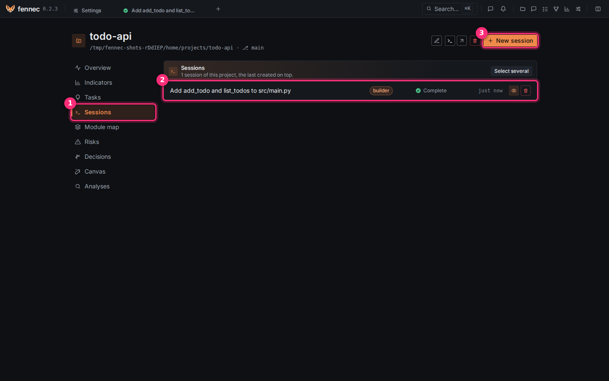
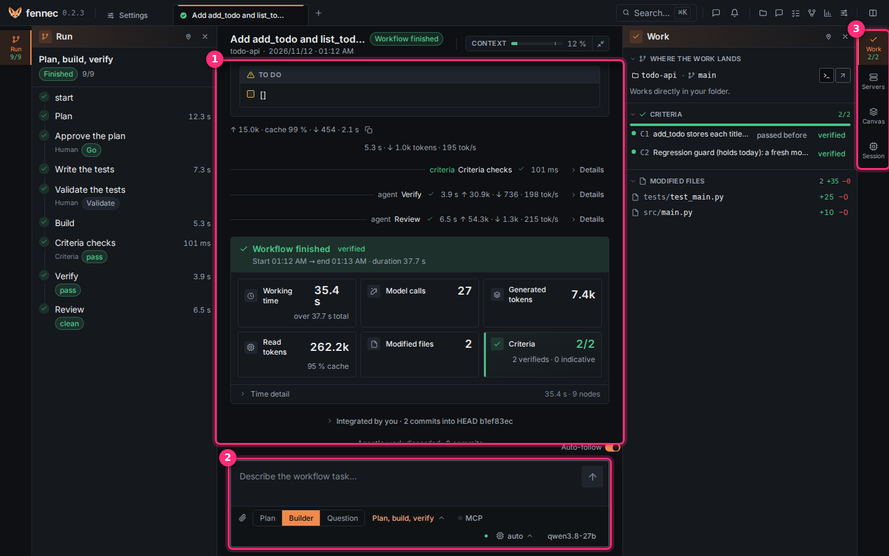

# Projects and sessions

A session is a conversation with an agent on one project; fennec keeps every session, its thread and its work. This page opens one, talks to the agent and reads what the session shows.

## Step 1: open the project's sessions

1. Click the **Projects** icon in the top bar.
2. Click your project.
3. Click **Sessions** ① in its left menu.



Each row ② shows the title, the agent (here **builder**), the status (here **Complete**) and when it last changed; the eye opens it, the bin deletes it. **Select several** deletes several at once.

Click a row to reopen a session, or click **New session** ③ to start one.

## Step 2: pick an agent and send a message



1. In the composer ② at the bottom, choose the agent: **Plan** (explores and agrees on a plan, changes nothing), **Builder** (changes the code and verifies it) or **Question** (answers about the project with sources, read-only).
2. Optional: change the workflow (**Plan, build, verify** here; **No workflow** talks to the agent directly, see [workflows](workflows.md)), the reasoning effort (**auto**) or the model, in the pickers next to it.
3. Type your message: `@` points to a file, `/` opens commands and skills.
4. Press `Enter` to send, or press `Shift+Enter` to add a line.

The thread ① shows the agent's messages, its tool calls and their results, with tokens and speed under each answer. While a turn runs, what you type is queued and reaches the agent between two tool calls. **Stop** stops the turn.

## Step 3: answer when the agent asks

When the agent asks a question, needs an approval or a plan decision, a decision bar appears above the composer. Click **Yes** or **No**, or type a free answer. The session shows **Waiting for you** on the home page under **Your turn** until you answer.

## Step 4: read the context rail

The rail on the right ③ has tabs: **Work** (where the work lands, the acceptance criteria, the modified files with a link to **Changes**), **Servers** (start the project's servers to try the change), **Canvas** (diagrams and drafts the agent wrote) and **Session** (tokens, cost, decisions, skills). A tab opens a drawer; the pin keeps it docked beside the thread; `Esc` closes it. **verified** marks what fennec computed itself; **indicative** marks what a model produced.

A workflow session also shows the **Run** rail on the left: the workflow's steps, their status and duration.

## If something goes wrong

- **Send** does nothing: a decision is pending above the composer; answer it first.
- The agent goes off track: press **Stop** and type what to do instead.
- The context gauge in the session header is nearly full: type `/compact` or click **Compact** next to the gauge.
- A session cannot be deleted: it is still running; stop it first.

---

## Reference

### Projects and sessions

The home page shows what needs you, recent sessions, and your favorite projects. Use **New chat** to start a conversation without a project, folder, or git. A chat can switch agents like a session; workflows stay hidden because they need a project.

Open a project from the home page or the **Projects** page. The project page shows **Recent sessions** and **All sessions**, and offers **New session in this project**. The session list shows the title, status, modified time, and agent. A session with unintegrated work shows **to integrate**.

Session titles appear in the top bar tabs and the project session list. The top bar keeps open session tabs. You can close a tab, use split view, and open the command palette to search a session, project, page, command, or skill. Themes and display options are on **Settings** > **Appearance**.

Session states include **Running**, **Complete**, **Stopped**, **Error**, **Truncated**, **Idle**, **Waiting for you**, **Awaiting your decision**, **Paused**, **Interrupted**, **Workflow running**, **Workflow finished**, **Workflow blocked**, **Workflow stopped**, **Workflow errored**, and **Awaiting your answer**.

### Agents and modes

An agent is a session mode: its method and the tools it may use. fennec provides embedded agents, you can add yours in `~/.agents/agents`, and a project can define agents in `.agents/agents`.

The composer menu groups agents by phase: **Start**, **Frame**, **Build**, **Understand**, and **Check**.

| Agent | Use | Access |
| --- | --- | --- |
| Plan | Explore the codebase and frame a plan | Read-only |
| Builder | Implement the task and verify it | Write allowed |
| Question | Answer a project question with sources | Read-only |

Switch the session agent from the composer's **Session agent** picker. The **Mode** picker shows the current mode. You can also change the model and the **Reasoning effort** for a session from the composer. The **Reasoning effort** picker offers **Auto (no effort)** and the efforts the session's model accepts. The choice wins over the agent's and the model's effort; a choice the current model does not accept falls back to auto. Changing it can make a local server re-read the whole context. Agents marked **Subagent** run only inside workflow nodes and are not offered as free session modes.

See [extending](extending.md) for writing your own agents.

### The composer

The composer is the **Message** input at the bottom of the session. Its placeholder is **Ask something… (@ for a file, / for a command)**.

- `Enter` sends; `Shift+Enter` adds a new line.
- `@` references a file.
- `/` opens commands and skills.
- **Attach an image** adds an image; you can also paste with `Ctrl+V` or drop a file. fennec accepts up to 10 files and 10 images, each at most 5 MB.

While a turn runs, a typed message is queued. Queued messages appear above the composer with **Queued** and **Remove from the queue**. fennec drops queued messages into the running turn between tool rounds. A slash command waits. The first queued message left starts the next turn when the current one ends. **Stop** clears the queue. A pending approval, waiver, or unfinished workflow run holds the queue until it is resolved.

**Stop** stops the turn and clears the queue. **Pause** asks a running workflow to stop after the current step. Open tool calls are closed after a stop or crash.

Slash commands include:

```text
/compact
/<skill>
```

`/compact` summarizes the conversation to free context. `/<skill>` loads a skill. Skills are `SKILL.md` packages from `~/.agents/skills` and the project's `.agents/skills`. Always-active skills are set on **Settings** > **Skills**.

### Questions and approvals

The pending plan and anything that blocks the agent appear in a decision bar above the composer.

When the agent asks a question, the turn ends and the answer is the next input. The question appears in the decision bar and shows **Question**, **Yes**, **No**, and **Or answer freely in the input area.**

Rule approvals and waiver requests also pause the turn. You answer in the decision bar. A waiver grants a protected file for 1, 8, or 24 hours in that session and writes an ADR to the session's `docs/adr/`. See [rules](rules.md) and [the review gate](review-gate.md#waivers).

### Delegated child sessions

With **Allow delegation** on in **Settings** > **Agents & delegation**, the plan, builder, and question agents can hand a self-contained task to a read-only agent in a hidden child session. The parent waits and receives only the child's final answer. The tool card shows the agent and task, marks the answer **indicative**, and shows the time the child ran. A child cannot delegate further. Only top-level web turns delegate.

### Compaction and context

Automatic compaction runs when the context reaches the threshold set by **Compact at (%)** in **Settings** > **Providers**. `0` disables automatic compaction. You can also type `/compact`.

Compaction opens a new window from the model's summary plus facts taken from the log, such as files changed and the last request. The log keeps everything.

The **Session** tab has a **Model context** section that shows **Session tokens**, **Calls**, **Estimated cost**, **Last call**, and **Composition**. Clicking the context gauge opens the **Session** tab on that section. The session header's context gauge has **Compact** to compact manually.

### Replaying a message

You can replay a typed message. fennec sends it again and keeps the log append-only.

### The context rail

The right-hand context rail shows what the model sees and what fennec computed. It has tabs: **Work**, **Servers**, **Session**, and **Canvas**. A plugin can add a **Plugins** tab or a tab of its own. The **Work**, **Servers**, and **Session** tabs show a live status. A tab opens a floating drawer; the pin docks it as a column beside the thread; **Close (Esc)** or the tab closes it.

fennec marks items **verified** when it computed them deterministically and **indicative** when a model produced them.

- **Work** shows **Where the work lands**, **Criteria**, the five most changed files with a link to **Changes**, and buttons to open a terminal and the IDE in the worktree.
- **Servers** starts the project's servers in the worktree. **Try it** opens it from the worktree row, the integration decision, or the last run's end card.
- **Session** shows cost and tokens, then **Decisions**, **Skills**, **Vision**, and **Plugins**. Its **Model context** section shows the context breakdown.
- **Canvas** lists the session's canvases; click one to open it. A canvas the agent writes opens itself and reveals the tab.

### Session workspace and changes

When a session uses a worktree, it works in a git worktree on a `fennec/…` branch. Your checkout is not written until you integrate.

The **Changes** page lists the branch's files in review order, shows the selected file's diff against the session's base, and can open the whole file in the IDE chosen in **Settings** > **Appearance**. Diffs are cut at 5,000 lines.

The **Work** tab's buttons open your terminal, IDE, or file explorer in the worktree. These tools run outside the sandbox with your environment. See [the sandbox](sandbox.md).

### Deleting sessions

From the project page, use **Delete the session**. A running session cannot be deleted. If a session has unintegrated work, fennec warns that its commits will be lost. Deletion removes the thread, workflow steps, agent workspace, and git branch. Usage figures remain in **Insight**. The action is permanent.

## Where to go next

- [Plans](plans.md)
- [Workflows](workflows.md)
- [The review gate](review-gate.md)
- [Tasks](tasks.md)
- [Understanding](understanding.md)
- [Settings](settings.md)
- [CLI](cli.md)
