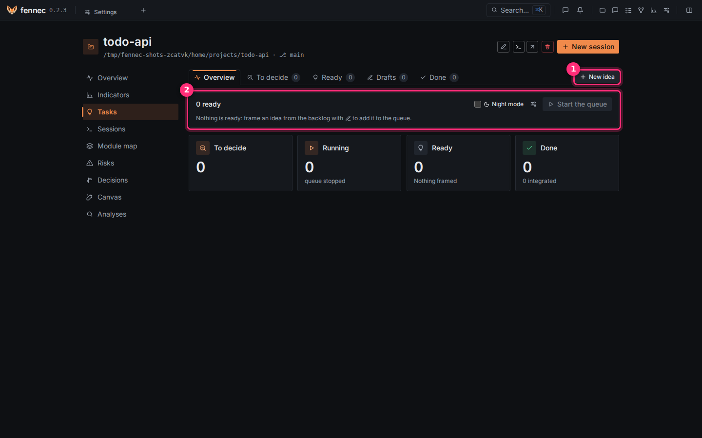
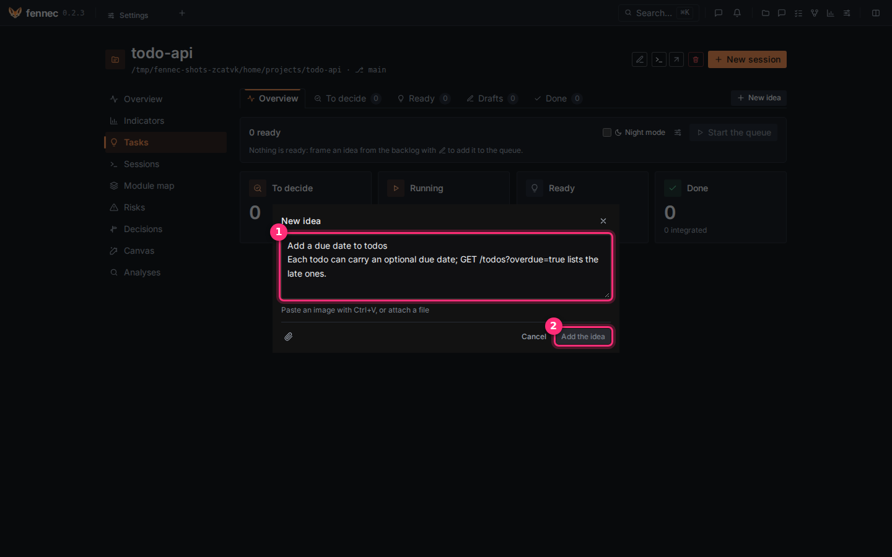
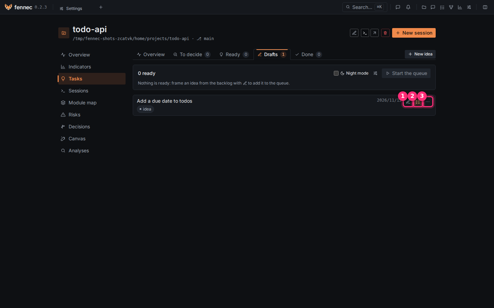
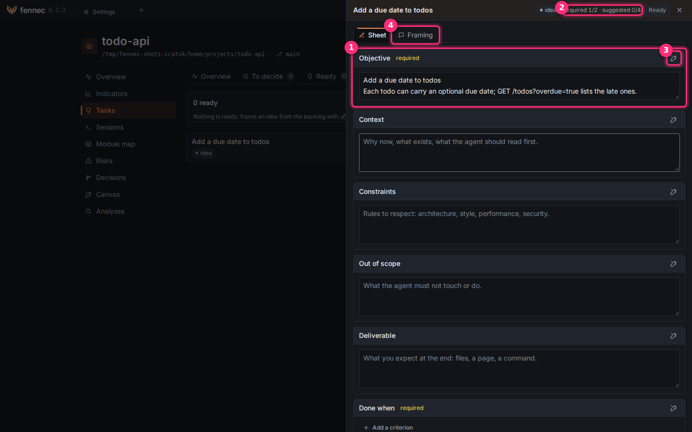
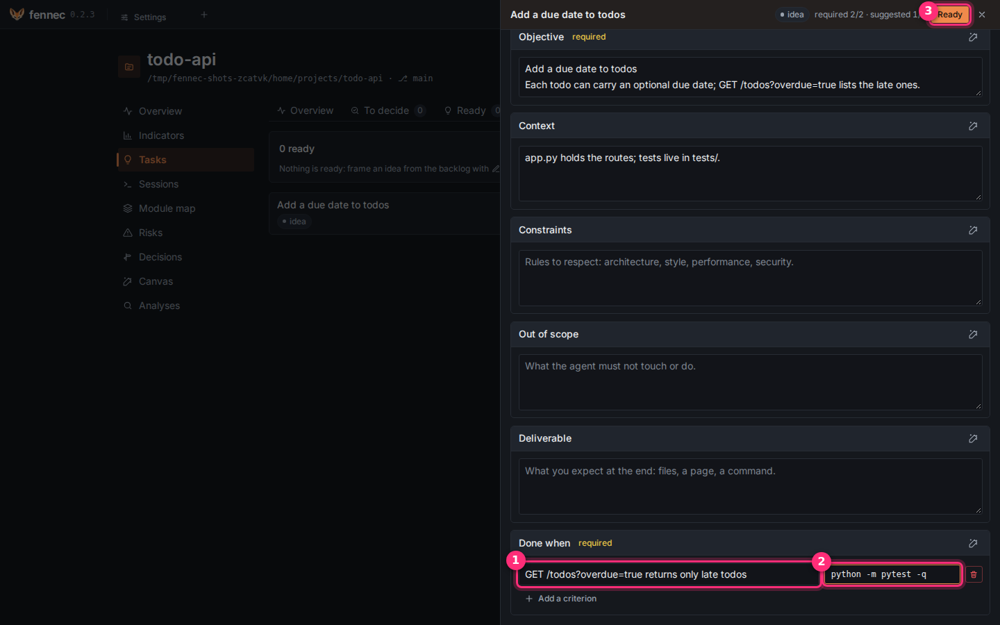
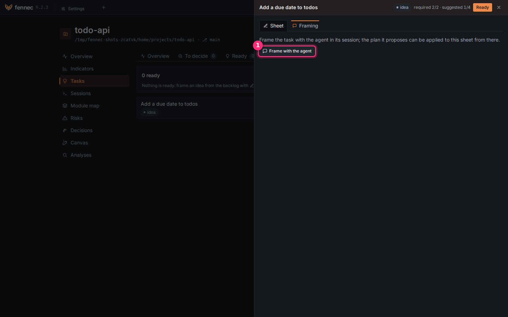
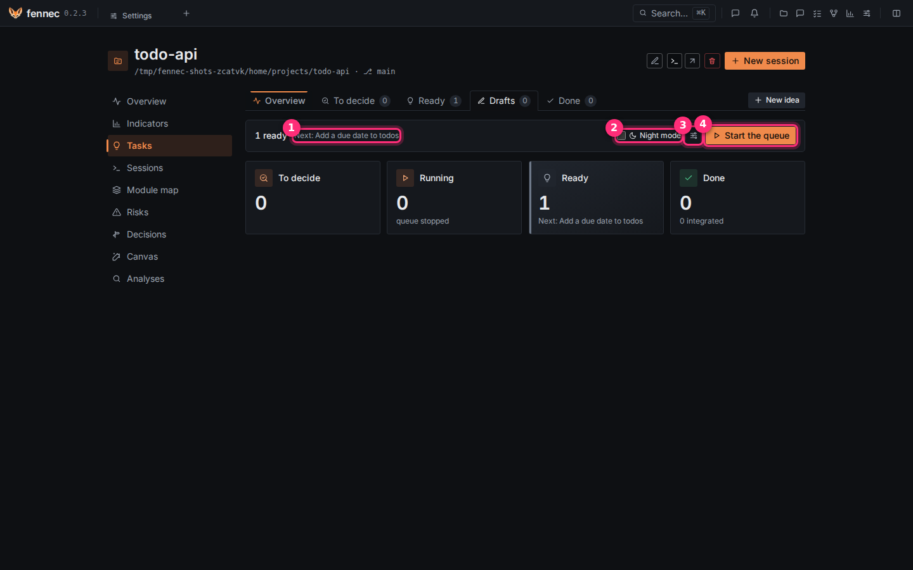
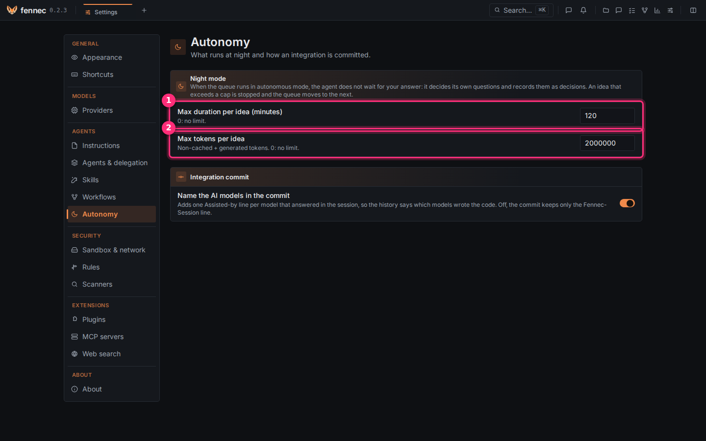

# Tasks and night mode

The Tasks board turns ideas into tasks with a sheet, then a queue runs the ready tasks one at a time, at night if you want. Nothing lands on your branch without your click.

## Step 1: add an idea

Open your project. Click **Tasks** in its left menu. The tabs are **Overview**, **To decide**, **Ready**, **Drafts** and **Done**. Click **New idea** ①. ② is the queue card: **0 ready** for now.

Type the idea in a few lines in ①: what should change, and why. You can paste an image or attach a file. Click **Add the idea** ②. The idea goes to **Drafts**.

## Step 2: turn it into a task

In **Drafts**, the idea row has three buttons:

- ① **Edit** changes the text.
- ② **Turn into a task** opens its sheet.
- ③ **Actions** ⋯ holds the other actions (see [Manage a task](#manage-a-task)).

Click **Turn into a task** ②. Once the idea has a sheet, the same button reads **Open the task**.

## Step 3: fill the sheet

The sheet opens in a drawer on the right. Its fields are **Objective**, **Context**, **Constraints**, **Out of scope**, **Deliverable** and **Done when**. Each field saves when you click outside it.

- ① **Objective** is required. fennec fills it from your idea.
- ② **required n/2** counts the required fields filled: **Objective** and **Done when**.
- ③ The wand, **Suggest with the model**, asks the model for a text. Click **Accept the suggestion** or **Reject the suggestion**. A field written by a model is marked indicative.
- ④ The **Framing** tab is step 4.

1. Type the background in **Context**. For example: `app.py holds the routes; tests live in tests/.`
2. Click **Add a criterion**.
3. Type the criterion in ①, on one line: `GET /todos?overdue=true returns only late todos`.
4. Optional: type a command in **Check** ②, for example `.venv/bin/python -m pytest -q`. fennec runs it after the build, in [the sandbox](sandbox.md), in the session's worktree: the system's tools and the checkout's `.venv` and `node_modules` are there read-only, the network is not; exit code 0 means the criterion is met. A criterion with a check is verified. Without one, an agent judges it, and the result stays indicative.
5. Click **Ready** ③. It turns on once **Objective** and **Done when** are filled. The task joins the queue with this sheet as its plan. If you edit the sheet of a ready task, it goes back to framing.

## Step 4 (optional): frame it with the agent

Not sure what to write? Open the **Framing** tab. Click **Frame with the agent** ①. A plan session opens for this task and reads the current sheet. The agent asks its questions, then proposes a plan. In that session, click **Apply to the sheet** to copy the plan into the sheet. Come back and click **Ready**.

## Step 5: start the queue

Close the drawer and open **Overview**. The cards count **To decide**, **Running**, **Ready** and **Done**.

- ① **Next:** names the task the queue runs first, the oldest ready one.
- ② **Night mode**: see step 6.
- ③ The caps icon: see step 6.
- ④ **Start the queue**: click it.

The queue runs the tasks one at a time. Each one runs the default workflow in its own session and its own git worktree. While it runs, the bar shows **queue running**. To stop, click **Stop the queue**, or **Stop the queue after the current task**.

When a task needs you, it moves to **To decide**: answer its question, or review its work. Integrating is your click, one task at a time: see [the review gate](review-gate.md).

## Step 6: run it at night

Tick **Night mode** ② before **Start the queue**. In night mode, the agent does not wait for you: it answers its own questions and records each answer as a decision, with its reason. It may never change the acceptance criteria: a change it would propose is recorded as a decision, and the work goes on against the approved criteria. A workflow step that waits for you still waits: in **Plan, build, verify**, the queue's workflow, the task stops at **Validate the tests** and shows as a question until you answer. Night mode applies to the run you start: tick it again next time.

Set the caps first: click ③.

**Settings** > **Autonomy** opens. ① **Max duration per idea (minutes)** is `120` by default. ② **Max tokens per idea** is `2000000` by default; it counts the tokens not served from cache plus the generated ones. `0` means no limit. A task that exceeds a cap is **halted**, and the queue moves to the next one.

## In the morning: the night report

On **Overview**, the **Night report** lists each task the queue ran: its duration, its tokens, the criteria passed and the decisions the agent took. Badges count the tasks **to review**, the **questions**, the **halted**, the **failed** and the **integrated**. Read the decisions first, then review the work. The report integrates nothing. Click **Mark as read** to hide it. Click **Reread** to show it again.

## Manage a task

| Action | What it does |
| --- | --- |
| **Frame** | Open a plan session for it. |
| **Edit plan** | Edit its plan. |
| **Reframe** | Frame it again. |
| **Start without framing** | Run the idea as a prompt. |
| **Restart** | Run it again. Only for a halted or failed task. |
| **Mark as done** | Mark it done. |
| **Drop** | Take it out of the queue. |
| **Remove** | Delete it from the board. Its session and history stay. |

All are in the **Actions** ⋯ menu of the task's row; the menu offers only the actions of the task's state. A task to review or with a question offers **Mark as done** and **Drop**: answer or review it from its session.

Agents can also propose tasks in a session. A card asks **Which tasks to add to the backlog?**: click **Add to the backlog** or **Add all**. Audit findings become tasks with **Create the tasks**.

## If something goes wrong

- **Ready** stays off: fill **Objective** and add one criterion in **Done when**.
- **Start the queue** is off: no task is ready. Open a task and click **Ready**.
- A task is **halted**: it reached a cap. Raise the cap in **Settings** > **Autonomy**, then click **Restart**.
- A task is **failed**: open its session from its row and read what happened.

Going further: the statuses, framing in detail and the cross-project view are below.

---

## Reference

### Framing an idea

A raw idea offers **Run** and **Turn into a task**. The board's highlighted action for a draft is **Turn into a task**; once it has a sheet, it is **Open the task**. The board row icon does the same thing. Framing with the agent is in the **Actions** menu as **Frame**.

Framing opens a plan session tied to the idea. If the idea has a sheet, the session sees the current sheet. The plan it proposes can be applied to the sheet with **Apply to the sheet**. If you edit the sheet afterwards, the framing session is told the sheet changed. If the idea has no sheet, the approved plan is kept verbatim with the idea and the idea is marked **ready**.

You can **Reframe** or **Start without framing** from the idea's **Actions** menu.

### Stages and statuses

The board groups work in tabs:

| Tab | What it contains |
| --- | --- |
| **Overview** | The counters, the queue bar and the night report. |
| **To decide** | Ideas and tasks that need your choice. |
| **Ready** | Tasks ready to run, in queue order. |
| **Drafts** | Ideas not yet ready. |
| **Done** | Finished or integrated work. |

Each idea also has a status:

| Status | Meaning |
| --- | --- |
| **idea** | A new idea in the backlog. |
| **framing** | A plan session is open for it. |
| **ready** | It is ready to run. |
| **running** | The queue is running it. |
| **question** | It needs your answer. |
| **to review** | It has work to review. |
| **halted** | It stopped at a night-mode cap. |
| **failed** | The run failed. |
| **integrated** | Its work was integrated. |
| **done** | The task is complete. |

### Cross-project view

The **Tasks** page shows a cross-project backlog with counts for **To decide**, **running**, **ready**, and **done**. The top bar shows a **To review** counter for work that needs your eye.

Use it to see which project has work waiting, halted, or ready.
