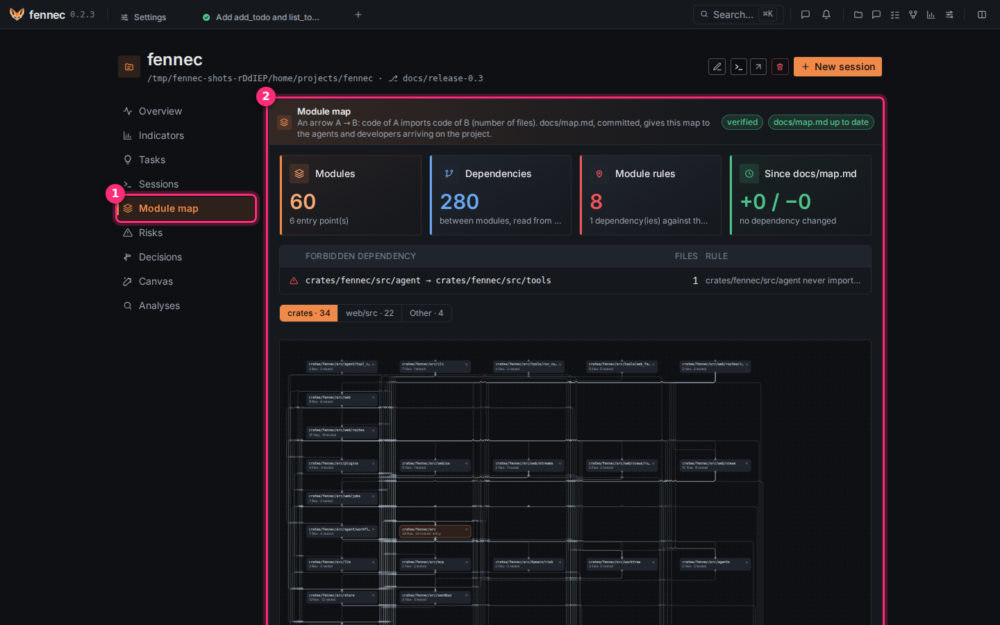
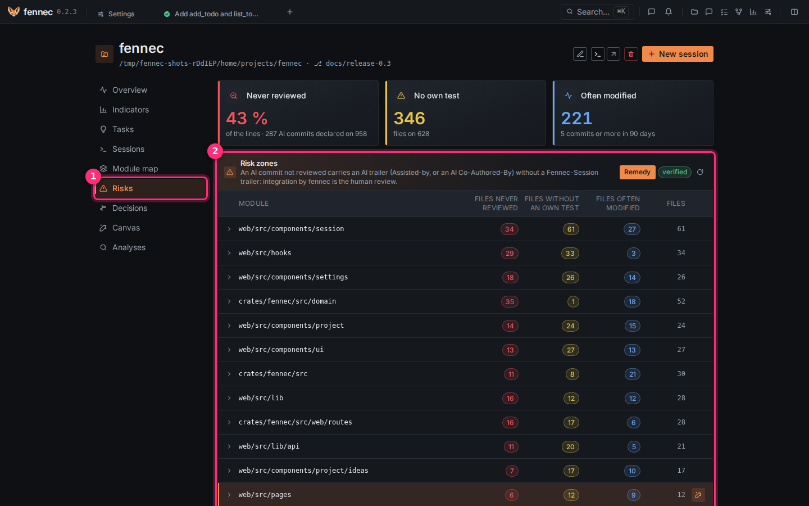

# Understanding the project

The project page shows how the code is built and where it is fragile, computed from the code and git, not by a model. Use it before you hand work to an agent, and to know what to read first.

**Before you start**: the module map reads Rust, TypeScript and JavaScript only. On a project in another language the map and risk zones stay empty.

## Step 1: read the module map

1. Open the project page.
2. Click **Module map** ① in its left menu.

② is the map. Tiles count the **Modules**, the **Dependencies**, the **Module rules** and what changed **Since docs/map.md**; the badge **verified** means fennec computed it from the imports, no model; the tabs below group modules by folder, and the graph shows an arrow A → B when code in A imports code in B.

1. Click a module to see only its links.
2. Click **Full screen** for a larger view.

- **Write docs/map.md** or **Update docs/map.md** writes the map as a file for later developers and agents. Commit it yourself.
- When `.agents/architecture` holds rules like `ui never imports store`, a broken rule is listed as **Forbidden dependency**.

## Step 2: find the risk zones

1. Click **Risks** ① in the left menu.

② lists the modules riskiest first, with their files never reviewed, without an own test, or often modified. It is computed from git, no model.

1. Click **Remedy** on a module. A read-only session proposes at most five tasks for it, riskiest first, and says which files to read first.
2. Choose which tasks enter the backlog.

**Measure again** recomputes the list.

## Step 3: read the decisions

1. Click **Decisions** in the left menu.
2. Click an ADR to read it.

- It lists the project's ADRs from `docs/adr/` with number, title, and status.
- If none exist, it shows **No ADR in docs/adr/.**
- Agents cannot write ADRs.

## Step 4: ask, or check your understanding

Click **Analyses**.

Each analysis is a read-only session; its report is a proposal, marked indicative.

- **Ask a question**, then **Send the question**: a sourced answer.
- **Check my understanding of this part**: the agent asks you questions about a module until you can explain it.
- **Write the project's charter**: drafts `AGENTS.md`.
- **Audit the architecture** or **Audit the security**: findings as cards. Tick the ones you want and click **Create the tasks**.

## If something goes wrong

- The map is empty with **No Rust, TypeScript or JavaScript source file found**: the project is in another language.
- **docs/map.md stale**: click **Update docs/map.md**, then commit the file.

---

## Reference

Use the project page to see a verified map of the code, its documentation, risk zones, and read-only analyses. Use the integration review to read a branch file by file before you integrate it.

### Project page

Open a project from the home page. The project page gives you **Decisions**, **Module map**, **Risk zones**, **Analyses**, sessions, tasks, and the integration review in a session. Map, risk, and module-rule data are computed from git and imports; agent reports are marked **indicative**.

### Module map and docs/map.md

The **Module map** shows modules and dependencies read from code imports. An arrow `A → B` means code in `A` imports code in `B`; the number on the arrow counts importing files. The map is **Extracted from code imports, no model**.

- Click a module to see only its links.
- Use **What this module corresponds to** to read the module's purpose.
- Use **Full screen** for a larger view.
- **Imports**, **Imported by**, and **Files** list the related files.

If no source file is found, fennec shows **No source file found (is the project a git repository?).**

`docs/map.md` gives the map to later developers and agents. The map state shows **docs/map.md up to date**, **docs/map.md stale**, or **docs/map.md missing**. Click **Write docs/map.md** or **Update docs/map.md** to write the file. Commit it when you want it to be the project's reference.

### Module rules and drift

`.agents/architecture` can contain module rules of the form `<A> never imports <B>`. fennec checks them against every dependency in the project map.

The **Module rules** tile shows **none in .agents/architecture**, **all respected**, or a count of dependencies against the intended architecture. The **Since docs/map.md** tile shows **no committed docs/map.md**, **dependencies added / removed**, or **no dependency changed**.

When rules are violated, the **Drift since docs/map.md** section lists **Forbidden dependency** rows with **Files** and **Rule**. If there are no module rules, it shows **No module rules in .agents/architecture (A never imports B): nothing to compare.**

### Decisions (ADRs)

The **Decisions** tab lists the project's ADRs, the MADR files in `docs/adr/`, in a navigation on the left (number, title, status); the selected one renders on the right. If none exist, it shows **No ADR in docs/adr/.** ADRs are protected from agent writes. They bind the project; they are not the same as decisions an agent records in a session.

### Risk zones

The **Risk zones** tab lists source files that are often modified, have no own test, or contain a high share of lines from AI commits never integrated through fennec. It is **Computed from git, no model**.

Each file can carry signals such as **never reviewed**, **no own test**, and a commit count. Use **Measure again** to recompute the list.

**Remedy** opens a read-only session on the riskiest module. The agent proposes at most five tasks, riskiest first, and tells you which files to read first. You choose which proposed tasks enter the backlog. **Propose tasks for these zones** does the same for the whole list.

### Analyses and questions

The **Analyses** tab opens read-only sessions. Each analysis changes nothing; its report is a proposal.

- **Ask a question** asks the project a question. **Send the question** opens a read-only answer, each point sourced.
- **Check my understanding of this part (dialogue with the understand agent)** asks you architecture-level questions about a module, flow, or design choice.
- **Write the project's charter** drafts `AGENTS.md` philosophy, layers, and rules, each point sourced. On an empty folder, it asks about goal, scope, and constraints, helps you choose the stack and architecture, and proposes first tasks, a walking skeleton first.
- **Audit the architecture** reports architecture findings.
- **Audit the security** runs the installed security scanners first, then reads the code. fennec does not install scanners; see **Settings** > **Security**.

Audit findings appear as cards. Select the findings you want and click **Create the tasks** or **Create {count} tasks**. Each checked finding becomes a project task that you can frame later.

### AGENTS.md and architecture rules

Agents read `AGENTS.md` but cannot write it. When a charter draft is ready, **Write AGENTS.md** writes it to the project root without a commit. If an `AGENTS.md` already exists, confirm **Replace**. Reread the file and commit it.

The `analyze` and `audit-architecture` agents can end with executable rules for `.agents/architecture`. **Add these rules to .agents/architecture?** asks you to append them. **Add the rules** writes them without a commit; the integration gate then checks them on every branch. Reread the file and commit it.

### Reviewing a branch

The integration dialog's review map lists the branch's files riskiest first. Each file can carry signals: **sensitive zone**, **outside the plan**, **bypass**, **architecture**, **conflict markers**, **weakened tests**, **often modified**, **no own test**, and **large change**. The **Commits** and **Files** sections are **Computed by fennec from the log**.

Use **Narrate** to have a read-only agent explain the change file by file in the review order. Its account is **indicative**.

Use **Understand** to have a read-only agent ask you questions about the branch until you can explain it. It is not an exam. When a sensitive zone changes, a comprehension dialogue is mandatory; if it has not been held, the gate shows **A sensitive zone changed and no comprehension dialogue was held on this version of the branch.** You can **Resume the dialogue** later. The state shows **Awaiting your answers** or **Dialogue held**.

The session's **Changes** page lists the same files in the gate's review order and shows the selected file's diff against the session's base. If uncommitted changes in your folder were worked on by the agent, the file is marked **your work included**.
