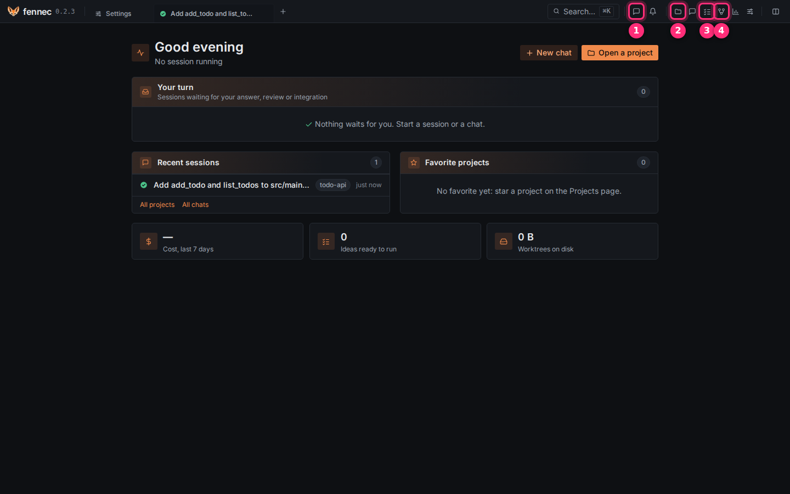

# Three ways to work

fennec offers three ways to hand work to a model: a chat, a session with an agent, and a workflow. This page helps you pick one; each section links to the page with the details.

| | Chat | An agent | A workflow |
| --- | --- | --- | --- |
| Where | **New chat** in the top bar | A session on a project | The **Workflow** picker in a project session's composer |
| Folder | A scratch folder, no git | Your project, or the session's worktree | The session's own git worktree |
| Who drives | You, message by message | You, message by message | The graph, pausing where you decide |
| What reaches your branch | Nothing: there is no branch | What you integrate at the [review gate](review-gate.md) | What you integrate at the review gate |

## Where to start

The top bar holds the entry points. Hover an icon to read its name.

- ① **New chat** starts a chat, with no project.
- ② **Projects** lists your projects. Open one and click **New session** to work with an agent or a workflow.
- ③ **Tasks** is the board of ideas that a queue runs one by one, at night if you want. See [tasks and night mode](tasks.md).
- ④ **Workflows** lists the workflows and lets you draw your own.

## Chat

A chat is a conversation with no project, no folder and no git. Use it to ask a question, draft a text, or try a snippet away from any repository.

- Start one with **New chat** in the top bar, or from the command palette. Chats are listed under **Chat** on the home page.
- A chat runs the **Builder** agent; there is no agent picker and no workflow picker.
- When a tool first needs a folder, fennec creates a scratch folder for that chat, `chat/<session-id>` next to fennec's database (by default `~/.local/share/fennec/chat/`). A plain conversation creates nothing on disk.
- Commands run in [the sandbox](sandbox.md), like in any session.
- Deleting the chat deletes its scratch folder.
- There is no worktree, no Changes page and no review gate: nothing in a chat can reach a repository. To work on code, open a project.

## An agent

A session on a project, where you talk to one agent directly. The agent decides its steps; you read, answer and steer.

| Agent | Use it to |
| --- | --- |
| **Question** | Ask about the project. Read-only, every claim sourced. |
| **Plan** | Explore the code and agree on a plan with its **Done when** criteria. Changes nothing. |
| **Builder** | Change the code and verify it. |

Other agents (audits, tests, understanding) are in the same picker, grouped by phase. A typical sequence is **Plan**, then **Builder** on the approved plan, then the review gate. See [projects and sessions](sessions.md) and [plans and acceptance criteria](plans.md).

## A workflow

A workflow runs a task as a graph of steps. You describe the task once; fennec walks the graph and stops where a human decision is needed. Models run only inside agent nodes and never choose the path.

In a project session, choose a workflow in the **Workflow** picker of the composer, then type the task. **No workflow** goes back to talking to the agent directly. **Plan, build, verify** is the one to start with:

1. A planner proposes the plan and its criteria; the run waits for your approval.
2. Tests are written from the criteria; you approve them.
3. The builder works in the session's own worktree.
4. fennec runs the criteria checks itself, then a fresh agent verifies the other criteria and reviews the diff. Findings go back to the builder, up to two rounds.
5. What is left comes to you, and the run ends at the review gate. Integrating is your click.

**Step by step** pauses the run before every node, so you can follow or redirect each step. **Quick build**, **Write documentation** and **Write a training course** are the other embedded workflows, and the **Workflows** page lets you draw your own. See [workflows](workflows.md).

## Which one?

- A question with no repository behind it: a chat.
- A question about a project, or a change you want to steer closely: an agent.
- A change you can describe up front and want checked before you review it: a workflow, starting with **Plan, build, verify**.
