# Workflows

A workflow is a graph of steps fennec runs for a task. fennec follows the graph itself; a model only works inside an agent step and never picks the path. Nothing lands on your branch without your click. This page shows how to pick a workflow, read one, and draw your own in about ten minutes.

## Pick a workflow for a session

Click **New session**.

In the message box, click the workflow picker. It shows **Plan, build, verify**.

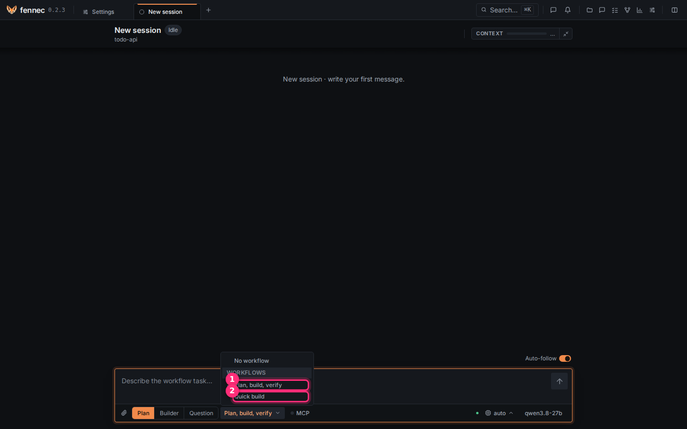

The list shows the workflows of this project.

- ① **Plan, build, verify** is for a full change. It plans. It asks your approval. It runs tests. It builds. It checks. It reviews.
- ② **Quick build** is for a small change. It has no plan. It has no review.

**No workflow** talks to the agent directly. The message you type is the task.

Two more workflows, **Write documentation** and **Write a training course**, are off by default. Turn them on in **Settings** > **Workflows** > **Optional workflows**.

## Open the workflow list

Click the **Workflows** icon in the top bar. It is the branching icon.

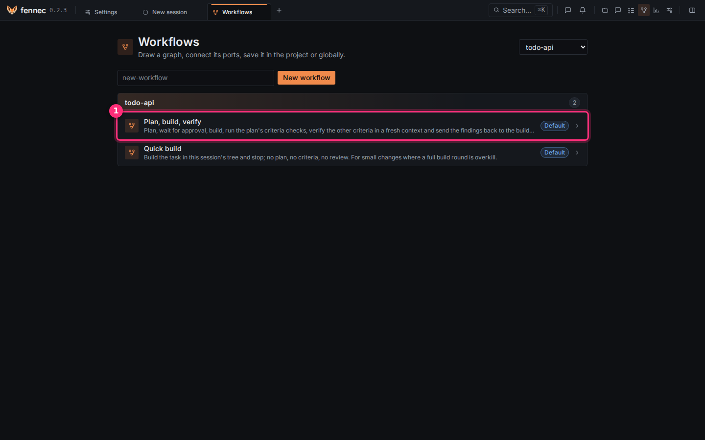

The page lists the workflows of the project chosen at the top right.

① is **Plan, build, verify**. The **Default** badge means it ships with fennec. Click it.

## Read a workflow

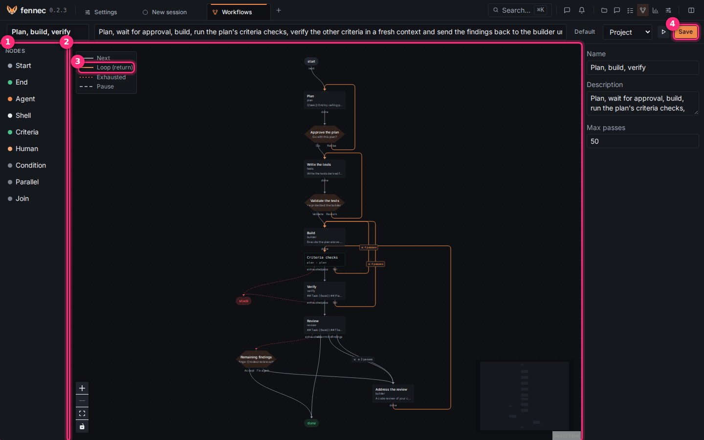

- ① **Nodes** is the palette of step kinds.
- ② is the canvas. The graph reads from top to bottom. **start** is at the top. **done** is at the bottom.
- ③ is the legend. Grey **Next** goes forward. Orange **Loop (return)** goes back. Red dotted **Exhausted** is taken when a loop reaches its cap. Dashed **Pause** stops before its target.
- ④ is **Save**.

### Step kinds

| Kind | What it does | Its exits |
| --- | --- | --- |
| **Start** | where the run begins, one per workflow | **next** |
| **End** | ends the run with an outcome (done, blocked…) | none |
| **Agent** | an agent works on a prompt | **done** (or the outputs you list) |
| **Shell** | runs a command | **success**, **failure** |
| **Criteria** | runs the checks of the plan's **Done when** list | **pass**, **fail** |
| **Human** | stops and asks you; one button per choice | one per choice |
| **Condition** | tests a value | **true**, **false** |
| **Parallel** | starts several branches at once | **branch** |
| **Join** | waits for all branches | **next** |

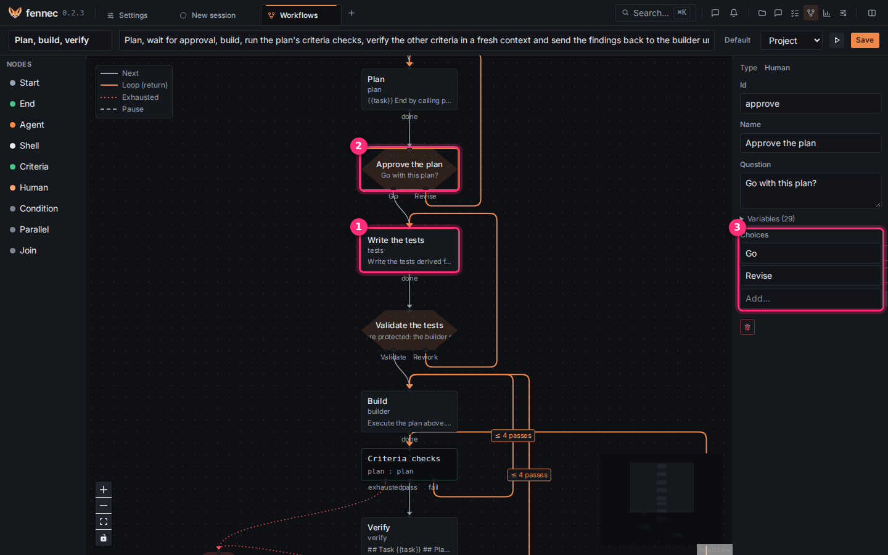

Scroll with the mouse wheel to zoom. Click a step to see its settings on the right.

- ① **Write the tests** is an agent step.
- ② **Approve the plan** is a human step. The run stops here and asks you.
- ③ **Choices** has one button per choice. Here it has **Go** and **Revise**. Each choice is an exit you wire.

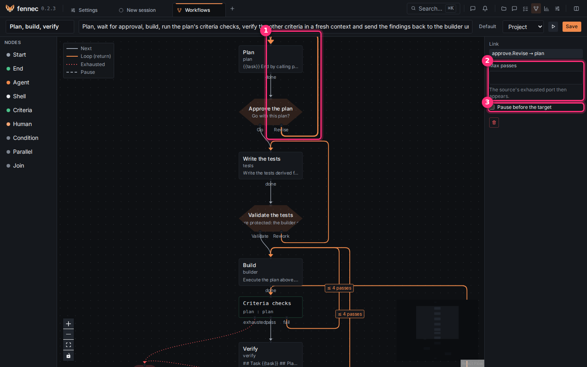

Click a link.

- ① is the orange loop from **Revise** back to **Plan**.
- ② **Max passes** is how many times the run may take this link. When the cap is reached, the run leaves by the source step's **exhausted** exit instead.
- ③ **Pause before the target** stops the run before the next step. It waits for **Continue**.

## Draw your own workflow

### Step 1: name it

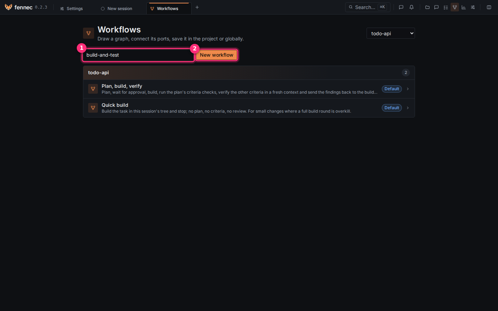

On the **Workflows** page, name the workflow. Use `build-and-test`, with lowercase letters, digits and dashes.

1. Type a name in ①.
2. Click **New workflow** ②.

The editor opens with **start** and **done**.

### Step 2: add the steps and wire them

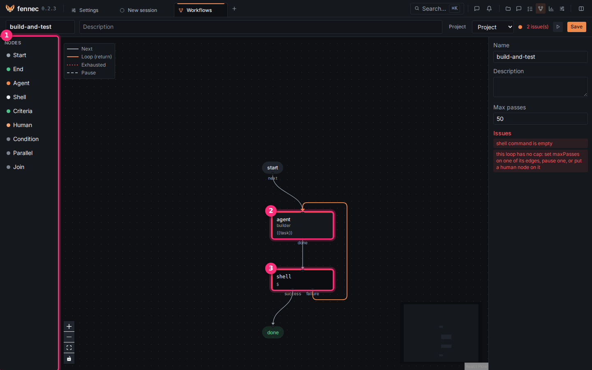

A step has exits at its bottom. They are small dots with a name. Drag from an exit to the next step to wire it.

1. Drag **Agent** from the palette ① onto the canvas, under **start**.
2. Drag **Shell** under it.
3. Wire **start** to the agent ②.
4. Wire the agent's **done** to the shell ③.
5. Wire the shell's **success** to **done**.
6. Wire the shell's **failure** back to the agent.

The loop shows orange. The right panel lists the **Issues** left. The **Run** and **Test** buttons stay off until there are none. Here, the command is empty and the loop has no cap.

### Step 3: fill in the steps

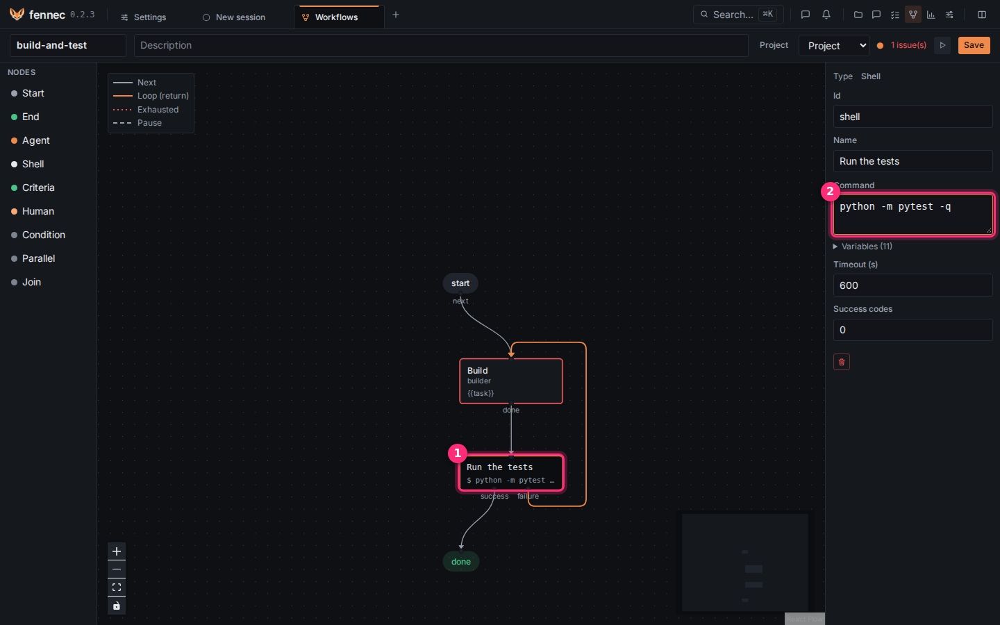

1. Click the agent step.
2. In **Name**, type `Build`.
3. Click the shell step ①.
4. In **Name**, type `Run the tests`.
5. In **Command** ②, type `python -m pytest -q`.

The agent step keeps the agent **builder** and the prompt `{{task}}`. `{{task}}` is the message you type when you start. Use your project's test command. Leave **Success codes** on `0`: exit code 0 means the tests passed.

### Step 4: cap the loop

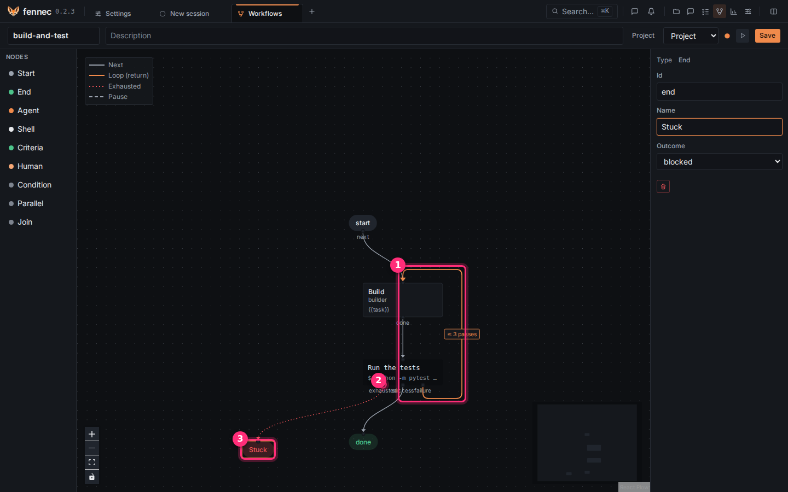

A loop without a cap could run forever, and fennec refuses it. Capping the loop makes a new exit **exhausted** ② appear on the shell step. The labels **exhausted**, **success**, and **failure** sit close together on the step; zoom in to grab the right dot.

1. Click the orange link ① from **failure** back to **Build**.
2. In **Max passes**, type `3`.
3. Drag **End** from the palette onto the canvas.
4. Wire **exhausted** ② to it.
5. Click it.
6. In **Name**, type `Stuck`.
7. In **Outcome** ③, choose **blocked**.

Now, after 3 failed rounds, the run stops as blocked. It does not loop.

### Step 5: save it

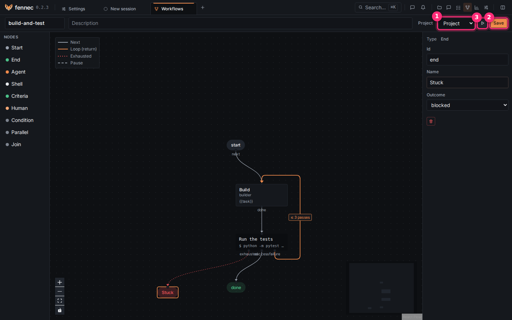

① chooses where the file goes. **Project** saves it in this project, as `.agents/workflows/build-and-test.workflow.json`; commit it to share it with your team. **Global** saves it for all your projects.

Click **Save** ②. The buttons ③ turn on: **Run**, then **Test step by step**.

### Step 6: try it step by step

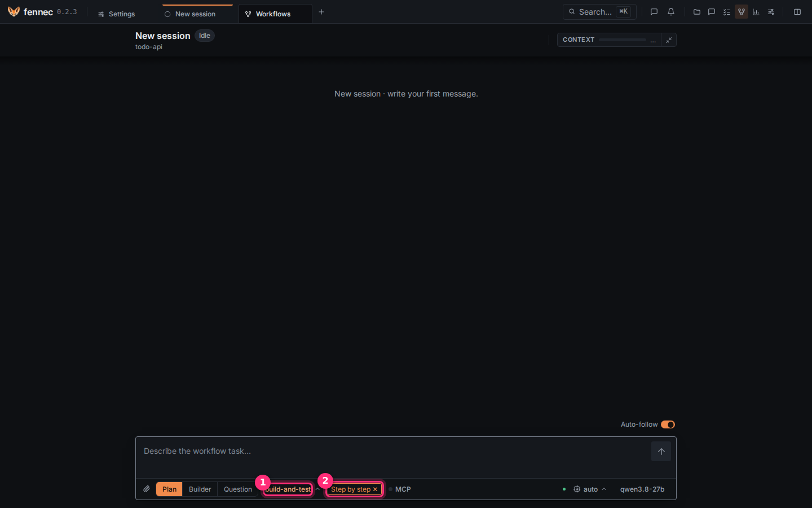

Clicking ③ (**Test step by step**) opens a new session. ① **build-and-test** is chosen, and ② **Step by step ✕** is on. The run stops before every step, so you can watch it.

1. Type the task.
2. Press Enter.
3. At each stop, click **Continue** or **Stop**.

To run without stops, use **Run** in the editor instead, or click the ✕ of **Step by step** before you press Enter.

A comment you type there is added to the next agent's prompt.

## While a workflow runs

- A strip above the thread shows the steps and where the run is.
- A human step shows its question, one button per choice, and a comment field. While it waits, answer it or stop the run; a typed message is refused.
- An agent step that runs in its own session (fresh context) may ask you a question there. The run shows **Answer it**: open the step's session and reply. Once the step finishes, the run goes on by itself. In a parallel branch, a question still ends the branch **blocked**.
- An interrupted run can be **Resumed**. It re-runs the step that was running, and it can be stopped.
- Workflow runs need the browser for their stops. The `fennec` command line does not run them.
- Once the run has ended, the workflow chip goes back to none. A message you send then is a plain turn on the same branch, for a quick fix without the plan and test gates, and the review gate still checks it. To run the workflow again, pick it in the chip.

## If something goes wrong

- **Test** stays off: read the **Issues** on the right and click a step marked red.
- A wire does not stick: zoom in and drop exactly on the target step.
- The run ends **blocked**: a loop hit its cap with no **exhausted** wire, or an agent did not say which exit to take.

Going further: the full reference (templates like `{{nodes.<id>.output}}`, parallel branches, validation rules, where files live) is below.

---

## Reference

### Node kinds

| Node | What it does | Output ports |
| --- | --- | --- |
| **Start** | Exactly one per workflow; carries the task. | `next` |
| **Agent** | Runs an agent with a prompt. `Context` can be **Session** or **New session**. **Verdicts on criteria** lets it judge criteria without a command. | Its **Outputs**, default `done` |
| **Shell** | Runs a command with a timeout and success codes. | `success`, `failure` |
| **Human** | Pauses for your choice. | One port per choice |
| **Condition** | Tests a template value with `equals`, `contains`, or `empty`. | `true`, `false` |
| **Criteria** | Reads the **Done when** list from a plan node, records it as the contract, and runs each `check:` command itself. | `pass`, `fail` |
| **Parallel** | Starts several branches at once. | `branch` |
| **Join** | Waits for all branches, then continues. | `next` |
| **End** | Ends the run with an outcome. | — |

An agent node with one output port ends when the agent ends its turn. With several output ports, the agent must end its last message with one line `Outcome: <port>`. If it does not, it is asked once more; if it still gives none, the run ends **blocked**.

### Human nodes and pauses

A human node has a question and at least one choice. The run pauses and the session waits for you. The UI shows the question with one button per choice and a comment field.

A paused edge stops the run before its target. A run started step by step pauses on every edge without changing the workflow file. A comment typed at a pause or at a human node is appended to the next agent node's prompt.

### Loops and caps

An edge may go back to any node. **Max passes** on an edge caps how many times the run takes it. When the cap is reached, the run follows the source node's `exhausted` port. When that port is not wired, the run ends **blocked**.

A workflow also has a step cap, default 50, as a guard against a graph that validation could not prove finite.

### Parallel branches

A **Parallel** node starts every edge of its `branch` port at once. Each branch runs in a child session up to the **Join** node all branches lead to. The **Join** waits for all of them, then continues in the parent.

Branches share the working directory, so at most one branch may contain a node that writes: an agent whose tools include file writes or command execution, or any shell node.

A branch never pauses: no human node and no paused edge inside a branch, and step by step does not pause inside one. A branch's agent nodes always run in new sessions. An `ask_user` inside a branch ends that branch **blocked**. Nested parallel nodes are not supported yet.

### Templates

Prompts, commands, condition values, and questions may use:

- `{{task}}`: the message the workflow was started with
- `{{nodes.<id>.output}}`, `{{nodes.<id>.port}}`: the latest run of a node
- `{{nodes.<id>.exitCode}}`: for a shell node
- `{{filesChanged}}`: the files changed since the run started, one per line
- `{{pass}}`: how many times the current node has run, from 1
- `{{comment}}`: the latest comment typed at a pause or a human node
- `{{criteria}}`: the run's criteria, one per line, with their check and status

A reference to a node that has not run yet expands to an empty string. An unknown name is a validation error. Shell commands receive the values shell-quoted.

### Where workflow files live

A workflow file is `<id>.workflow.json`. fennec looks in this order for an id:

1. the project's `.agents/workflows/`
2. `~/.agents/workflows/`
3. the defaults embedded in fennec

The first file found wins. A project workflow therefore overrides a global one, and a global one overrides an embedded default.

The id must match `^[a-z0-9][a-z0-9-]*$` and equals the file name. The editor saves into the project or global folder. An embedded default is copied on its first save.

### Validation

Validation is checked on save and before a run, and shown in the editor next to the faulty node or edge:

- one **Start**, at least one **End**, unique ids, known agent ids
- every output port wired at most once, except `parallel.branch`
- every node reachable from **Start**, and an **End** reachable from every node
- every **Parallel** has a matching **Join** that all its branches reach, disjoint branches entered only from the **Parallel**, no pause inside, at most one writing branch
- templates use known names
- a cycle without any **Max passes** edge, paused edge, or **Human** node on it is an error
